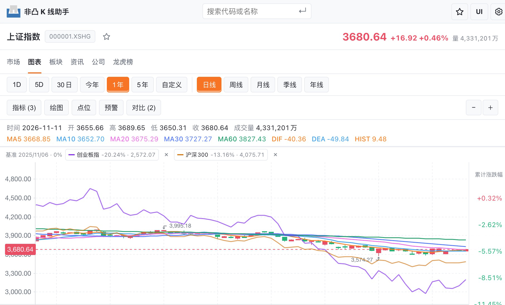
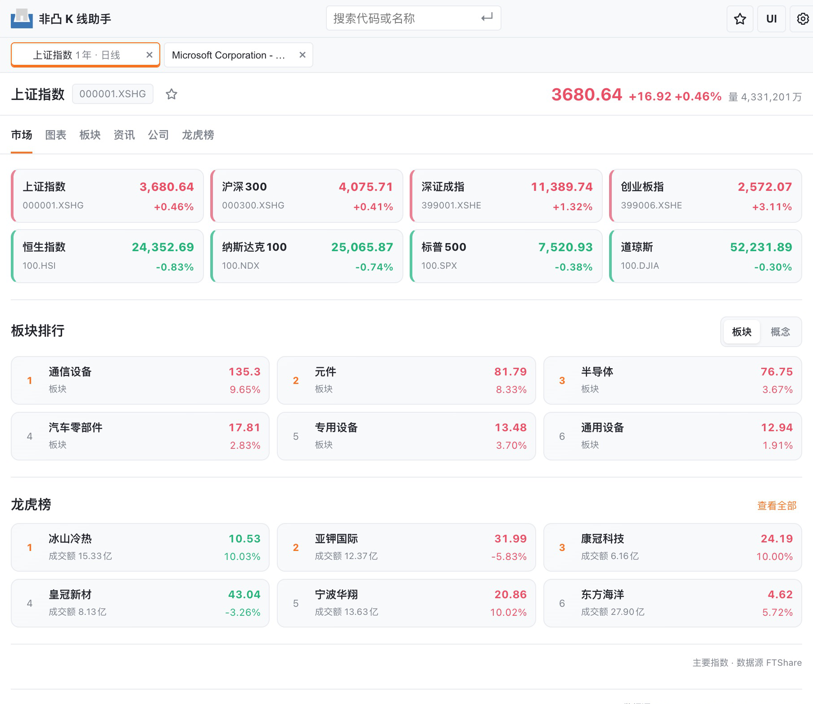
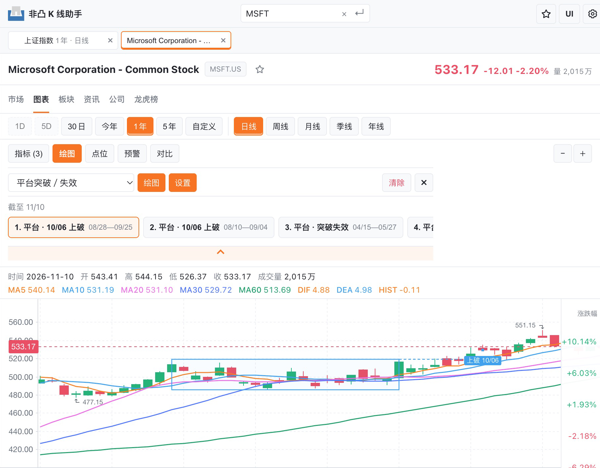

# FT K-Line · 非凸 K 线助手

Explore markets, analyze price action, and draw directly on charts through **DeepSeek Harness** or **Codex**.

[简体中文](README.md) · English

[](https://github.com/FTShare-Lab/dsh_kline/actions/workflows/install.yml) [](https://github.com/FTShare-Lab/dsh_kline/releases) [](LICENSE)

[Explore](#explore) · [Install](#install) · [Get started](#get-started) · [Data and scope](#data-and-scope) · [Documentation](#documentation)

> This page describes **v0.6.9**. Published packages are listed in [Releases](https://github.com/FTShare-Lab/dsh_kline/releases); see the [npm guide](docs/npm-release.md) for publication and installation details.

## Explore

### Compare performance on the main chart

Overlay stocks, indices, or ETFs as background lines while retaining the main symbol's candles and indicators. Search for symbols or choose an index shortcut; hide or remove each comparison independently.

[](docs/images/main-chart-comparison-v0.6.9.png)

*Shanghai Composite daily candles with CSI 300 and ChiNext. Lines are normalized to the shared baseline shown in the legend to compare cumulative returns, rather than raw prices. Comparison lines have no additional indicators. Click an image for the original.*

### Start with the wider market

Browse major mainland China, Hong Kong, and US indices alongside sector rankings and unusual-trading lists. Open a symbol to continue with its chart, news, and company information.

[](docs/images/market-overview-v0.6.9.png)

### Draw automatically or choose your own anchors

**Draw** brings together horizontal levels, trend lines, parallel channels, range boxes, Fibonacci retracements, ABC annotations, double tops/bottoms, head-and-shoulders patterns, platform breakout/failure states, and basic nine-counts. Draw the latest eligible result, choose another candidate, or pick anchors manually. Closing the controls preserves drawings; **Clear** removes them.

[](docs/images/platform-breakout-msft-v0.6.9.png)

*MSFT daily chart: the platform spans August 28–September 25, with an upward breakout confirmed on October 6. Subsequent candles do not expand the frozen box. This is a rule-based finding, not a return forecast.*

These are actual **DSH Web captures from November 11, 2026**, saved as lossless PNGs at native Retina resolution. Prices are snapshots. Codex Desktop shares the calculations and displays charts in an App card; appearance depends on the host.

| Capability | What you can do |
| --- | --- |
| Indicators | SMA, EMA, VOL, MACD, KDJ, RSI, BOLL, ATR, VWAP |
| Natural-language drawing | Create, edit, recolor, rename, or delete specific drawings on the same chart as the workbench |
| Levels and review | Analyze support/resistance, add custom levels, review interval returns and drawdown |
| Market research | Indices, sectors, news, company information, unusual trading; subject to coverage and permissions |
| Watchlists | Favorites, groups, sorting, importing, batch opening; DSH retains them across conversations |
| Technical functions | Query and calculate 201 TA-Lib functions; selected SMA/EMA/BBANDS results support guarded drawing |

## Install

Supports macOS, Linux, and native Windows. First launch downloads dependencies and may take several minutes.

### DeepSeek Harness

Install a working DSH Web host and **Python 3.11+**, then find `dsh_kline` in the plugin marketplace or run:

```bash
dsh plugin --profile web add github:FTShare-Lab/dsh_kline
```

Enable it, then click **K** on the right or request analysis in chat. Better Sidebar is optional; the regular sidebar works without it.

### Codex

Install a plugin-capable Codex, Git, **Node.js 22.19+**, and **Python 3.11+**:

```bash
codex plugin marketplace add FTShare-Lab/dsh_kline --ref main
codex plugin add ft-kline@ftshare
```

Reopen Codex and ask “Open China Merchants Bank's daily chart.” FTShare is this project's public GitHub plugin source; it is not listed in the official public plugin directory.

| Host | Interactive chart and manual drawing | Chat-driven drawing | Quotes and structured analysis |
| --- | --- | --- | --- |
| DSH Web | Yes | Yes | Yes |
| Codex Desktop | Inside an App card | Yes | Yes |
| Codex CLI | Unavailable | No chart writes | Yes |

For updates, fixed-release ZIPs, migration, credentials, and troubleshooting, see the [complete guide](docs/guide.en.md).

## Get started

**Ask in chat:**

```text
Open Tencent's daily chart and analyze its volume, MACD, and RSI over the last month.
Draw a blue horizontal line at 31.2 called “Key support”.
Move Key support to 30.8; leave the other drawings unchanged.
Find and draw the latest eligible double bottom; explain its current state.
```

**Use the workbench:** Search a symbol → choose a range and timeframe → enable indicators → choose a tool under **Draw** and click **Draw now**. Use **Pick anchors manually** for your own points and **Settings** for parameters. Drawings appear directly without a separate save step.

**Levels** analyzes support/resistance; **Compare** adds background lines. Controls that do not fit move into the row's overflow menu. Closing a panel does not delete drawings. See [chat-driven drawing examples](docs/drawing-examples.en.md).

## Data and scope

- **Sources:** Configure and test an FTShare key under **Settings → Data source**. Without a key, supported A-share, HK/US daily-history and index fallbacks can be tried; public-source coverage varies. Intraday data, news, and company information depend on the corresponding permissions.
- **Patterns and nine-counts:** Currently use loaded, closed daily bars for mainland China, HK, and US equities. ABC provides annotations and candidate assistance, not professional Elliott-wave recognition. Basic nine-counts do not include the full DeMARK 13 Countdown.
- **Drawings and state:** Anchors must match actual loaded candles. Unverified sources, expired results, or ambiguous active views stop edits. Drawing restoration across service restarts, mouse dragging, and undo are not supported.
- **Host differences:** DSH watchlists persist at user level. Codex charts, watchlists, and App-entered keys remain in connection memory and do not inherit DSH configuration.

Quotes may be delayed; technical analysis is for research and learning. See [keyless coverage](docs/anonymous-market-support.md) and the [HK/US daily-data contract](docs/free-foreign-daily.md).

## Documentation

| Topic | Guide |
| --- | --- |
| Installation, updates, credentials, troubleshooting | [Complete guide](docs/guide.en.md) |
| Automatic drawing and extensions | [Shared drawing architecture](docs/automatic-drawing.md) |
| Pattern definitions and real samples | [Rules](docs/price-pattern-rules-v1.md) · [Samples](docs/price-pattern-samples-v1.md) |
| Technical functions | [Read-only and drawable functions](docs/chart-functions.md) |
| Host and data integration | [Embedding](docs/embedding.md) · [Provider adaptation](docs/provider-adaptation.md) |
| Releases and verification | [Changelog](CHANGELOG.md) · [v0.6.9 candidate](docs/release-notes-v0.6.9.md) · [Acceptance](docs/release-acceptance-v0.6.9.md) |

[MIT License](LICENSE) · [Frontend provenance](PROVENANCE.md) · [GitHub Releases](https://github.com/FTShare-Lab/dsh_kline/releases)
