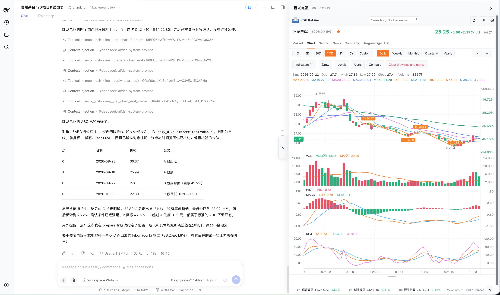
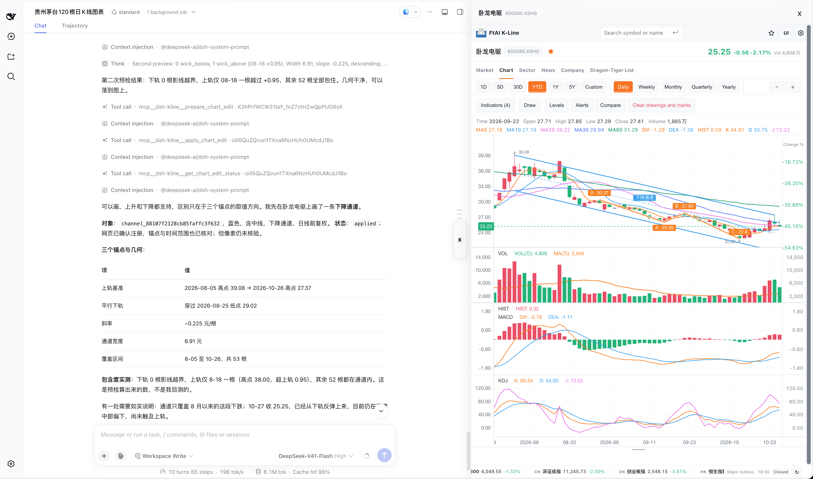

# 非凸 K 线助手 / dsh_kline

[简体中文](README.md) | English

[](https://github.com/FTShare-Lab/dsh_kline/actions/workflows/install.yml) [](https://github.com/FTShare-Lab/dsh_kline/releases) [](#get-started) [](LICENSE)

Analyze, draw, and revise a K-line chart through natural language in DeepSeek Harness—or pick anchors yourself on the chart. Chat and the drawing workbench share the current chart and its protected objects: levels, trend lines, channels, range boxes, Fibonacci retracements, ABC labels, and selected drawable indicators.

> Quotes and technical analysis are for research and education only, not investment advice.

[Features](#what-it-helps-you-do) · [Live drawing preview](#preview) · [Install and start](#get-started) · [Sidebar compatibility](#sidebar-compatibility) · [Drawing tools](#drawing-through-chat-and-the-workbench) · [Data sources](#quotes-and-data-sources) · [FAQ](#frequently-asked-questions)

## What it helps you do

- **Start with a sentence**: ask for a chart, a trend read, or an indicator analysis in natural language.
- **Explore on your own**: open the K-line workspace, search a name or ticker, and switch among daily, weekly, monthly, quarterly, yearly, and available intraday views.
- **Read trend and momentum**: use MA, volume, MACD, KDJ, RSI, BOLL, ATR, and VWAP.
- **Put your analysis on the chart**: create horizontal/trend lines, parallel channels, range boxes, Fibonacci retracements, and ABC polylines by chat or point selection. Preview first; save only when the result looks right.
- **Explore TA-Lib**: search and run all 201 TA-Lib 0.8.2 functions read-only on the loaded chart. Only selected SMA, EMA, and BBANDS results are directly drawable in this release; the other functions are not advertised as chart objects.
- **Find price areas**: identify support and resistance, or draw and save your own levels and notes.
- **Compare and review**: overlay indices or symbols, then select a period to inspect return, range, drawdown, and activity.
- **Add context**: use Market, Sectors, News, Company, and Dragon & Tiger List views for indices, sector rankings, capital-flow events, news, company profiles, fundamentals, and ownership data.
- **Build a watchlist**: save symbols, create or rename groups, sort, import, and open several at once. Watchlists stay in your current browser.

## Preview

Live natural-language example: DeepSeek screened the watchlist for an ABC **candidate** in Wolong Electric, checked the four 0/A/B/C anchors against candles, and used the plugin to draw them. This unedited full-page capture shows the conversation, application result, and visible chart together. The host interprets the pattern; a rules-based candidate is not a verified Elliott-wave conclusion.



In the same chart, a follow-up natural-language request adds a descending channel. DeepSeek checks its three-anchor geometry and price deviations; the plugin applies it as a separate object while preserving the ABC labels. The lines are visible, but their trading relevance still requires independent judgment.



## Codex private preview (v0.6.0)

`ft-kline` is an isolated Codex plugin. ChatGPT Desktop provides the complete chart, manual workbench, and guarded natural-language drawing; Codex CLI provides market data, analysis, TA-Lib, and structured output only, and explicitly does not support interactive charts.

Codex chart state, function results, and an App-entered FTShare key remain in current-connection memory only. They are cleared when the resource or connection closes or after 30 minutes idle. `FTSHARE_API_KEY` from the environment has priority; an App key is neither echoed nor written to disk. Current-chart writes must use `get_chart_context → prepare_chart_edit → apply_chart_edit → get_chart_edit_status`; server commit, UI receipt, and pixel verification are deliberately separate states.

This version is private-marketplace preview only and is not a public-directory submission. See the [v0.6.0 release notes](docs/release-notes-v0.6.0.md) and [acceptance checklist](docs/release-acceptance-v0.6.0.md). DSH installation remains unchanged below.

## Get started

### 1. Install and enable

Find `dsh_kline` in the DeepSeek Harness plugin marketplace. If the catalog has not refreshed yet, install directly from GitHub:

```bash
dsh plugin --profile web add github:FTShare-Lab/dsh_kline
```

The first launch prepares its runtime automatically. Later, update from the marketplace or Settings when a new version is available.

The plugin supports macOS, Linux, and native Windows. Install a working DSH Web host and Python 3.11 or newer first. On Windows, use the [python.org installer](https://www.python.org/downloads/windows/) with the Python Launcher enabled. Git Bash and WSL are not required. First-launch details are stored in `dsh_kline/bootstrap.log` under the user cache directory; the Windows default is `%LOCALAPPDATA%\dsh_kline\bootstrap.log`.


### 2. Choose either entry point

**Ask AI** in a conversation, for example:

- `Show the K-line chart for Zijin Mining and its trend over the last month`
- `Show Tencent's daily chart and mark support and resistance`
- `Analyze NVIDIA's volume, MACD, and RSI over the past month`
- `What recent news and fundamentals should I know about this company?`
- `Draw a blue level at 1300 on the current chart, then change that object to green`
- `Propose three anchors for a descending channel; explain the deviation and wait for my confirmation`
- `Screen my watchlist for ABC candidates; verify one symbol's 0/A/B/C pivots on its daily chart before drawing, and tell me whether C is confirmed`

**Open the workspace directly**: click the K button on the right, or choose **非凸 K 线助手 / dsh_kline** from the `+` menu where workspace Tabs are available. Search by name or ticker; exchange suffixes are not required.

Both entry points can operate on the same new drawing objects in the active chart. In the chart toolbar, **Draw** opens the drawing workbench: choose a tool, click candles or enter parameters, preview, then confirm. Conversations retain separate chart states; watchlists remain user-level data.

## Using the chart

1. Search for a company or ticker at the top.
2. Pick a time range and candle timeframe. Intraday availability depends on the market and data entitlement.
3. Enable the indicators you need, then pan, zoom, or use the crosshair for detail.
4. Select **Key levels** for support and resistance, or **Draw** to choose a drawing tool, pick anchors or enter parameters, and save the preview. Manage your own price lines under **Levels**.
5. Click two candles in sequence to review return, range, drawdown, and trading activity for that interval.
6. Select the star beside a symbol to add it to a watchlist.

Where a **UI** menu is available, choose Automatic, Classic sidebar, or workspace Tab. Automatic uses the best interface your current Harness supports; when Tabs are unavailable, the regular K-line sidebar continues to work.

### Sidebar compatibility

DeepSeek Harness provides its own right sidebar, so **Better Sidebar is not required** to open the K-line sidebar. When a compatible Better Sidebar is installed, the plugin can also open the chart as a workspace Tab. This is an optional UI integration, not a requirement for quotes, indicators, or drawing. Use **UI** to choose Automatic, sidebar, or Tab; Automatic selects from the interface capabilities exposed by the current host. Installing Better Sidebar alone does not mean every version and layout has been validated.

## Quotes and data sources

FTShare is the default optional source. After you configure an API key, the plugin exposes the quote, intraday, news, and company-data capabilities available to your account. Availability differs by market and plan.

Only unadjusted (`none`) single-session one-minute requests for regular A-share stocks prefer FTShare's raw realtime feed. Forward/backward requests (including qfq/hfq) use history with the matching `adjust_kind`; failure never silently falls back to raw realtime rows. Indices, ETFs and multi-session history retain their applicable endpoints. Full-session returns and adjustment-isolated caching are unchanged; routing is not independent verification of vendor-adjusted prices.
Explicit source minute size survives ingestion, local redraw and workspace state. Missing/invalid metadata stays unknown; it is not inferred from timestamp spacing, UI labels or the previous symbol. Unconfirmed sources still cannot authorize guarded drawing.

The plugin reuses FTShare credentials in this order: an `FTSHARE_API_KEY` already injected into the current DSH service, an explicitly configured `FTSHARE_API_KEY_FILE`, a Key saved in the DSH FTShare settings, and a local credential previously saved by this plugin. If the key is already available to the process that starts DSH, it is used automatically. Installing the FTShare SDK alone, or storing a key in another app's private configuration, is not enough for the plugin to read it.

When the DSH FTShare settings plugin is installed, the host publishes its Key to the MCP server, which re-reads it before every request — so adding, rotating, or clearing the Key in the settings page needs no dsh restart. That Key belongs to the settings page; this plugin never displays or clears it.

For safety, the plugin never scans `.env` files, shell configuration, keychains, or other apps' configuration files, and never displays a key or path. **Settings → Data source** identifies the active source; use **Manage FTShare configuration** to paste and test a replacement key, either for the current session or saved locally for future launches.

Theme and language follow the DSH host by default. **Settings → Theme/Language** also offers manual choices and a way back to **Follow host (default)**.

[FTShare's free-plan endpoints](https://market.ft.tech/gateway/doc/p/pb8eizu3) still require a registered API key. With no key at all, the plugin has an independent free-data fallback only for selected broad-market indices; fresh individual-stock and ETF charts are not guaranteed. Existing valid OHLCV data, including rows supplied by the host, can still drive local indicators and drawing. The UI reports the applicable source or error when data is rate-limited, unavailable, or outside the account's entitlement.

## Frequently asked questions

**Why is an intraday chart unavailable?**
Intraday access depends on the symbol's market, your account plan, and the source's currently supported coverage. Test the connection in Data source first. Daily, weekly, and monthly views do not require the intraday entitlement, but individual-stock candles still need a working data source; FTShare's free plan requires an API key too.

**What if the first launch fails on Windows?**

Run `py -3.11 --version` in a terminal (a newer version is also supported) to confirm that the Python Launcher can find Python, then inspect `%LOCALAPPDATA%\dsh_kline\bootstrap.log`. For a custom Python location, set `DSH_KLINE_PYTHON` to the full `python.exe` path before starting DSH Web. Installing DSH Web itself and troubleshooting its Windows sandbox remain host-level concerns covered by the DSH documentation.

**Why do two conversations show different charts?**
This is intentional: each chart belongs to its conversation, so an analysis in one conversation cannot replace another's chart. Search or start a new analysis in the other conversation when needed.

**Why can data differ slightly from another platform?**
Quotes can be delayed and may differ with adjustment policy, exchange conventions, market-close state, and upstream services. Use appropriately licensed feeds for commercial, high-frequency, or latency-sensitive work.

## For AI and developers

### Drawing through chat and the workbench

On a source-checked current chart, the host can interpret a request and use the plugin's calculate → prepare → apply → verify flow. The workbench exposes the same protected objects for manual selection, preview, and editing. Selected families are horizontal levels, two-anchor trend segments, three-anchor finite parallel channels, rectangular ranges, two-anchor Fibonacci retracements, manually supplied or host-proposed-and-checked ABC anchors, and standalone SMA/EMA lines or BOLL three-line bands. Names, four colors, channel midlines, and rectangle fills are supported. The plugin draws ABC labels; **it does not automatically recognize Elliott waves**, and candidates are not definitive conclusions.

Try “draw a blue level at 31.2 called support”, “move support to 30.8; leave everything else”,
or “propose a descending channel with three anchors and explain deviations; wait for approval”.

The host interprets language, analyzes candles and selects anchors. The plugin observes,
measures, executes and reports; it does not embed another AI or replay predefined drawing skills.
Explicit parameters may execute directly; proposal-first requests must wait for approval.
Host explanations and professional anchor selection can be wrong and require user judgement.

Foundation scope and limitations:

- Daily/weekly paths are the main acceptance scope. Anchors must match actual loaded bars.
  The plugin does not guess missing dates, snap anchors or fetch extra candles to repair edits.
- Trend segments and channels are finite, with no automatic extension or logarithmic geometry.
  Channels and rectangles retain their creation interval.
- Guarded edits target stable IDs without resetting candles, indicators or the viewport.
  Manual drawings, automatic annotations and AI objects remain separate.
- Confirmed drawings can restore and be edited after browser refresh within the same host run.
  Conversations are isolated. Returning to a conversation restores its last confirmed drawing
  checkpoint, **not necessarily its last manually selected interval, range or viewport**.
- Workbench point selection and form editing are supported; AI mouse dragging, undo, cross-process old-chart editing and complete automatic failure
  recovery are not supported. Unknown outcomes stop automatic retries.
- **Clear drawings and annotations** asks for confirmation, then removes AI objects,
  analysis annotations, manual drawings, and custom levels for the current symbol and interval.
  Indicators and alerts remain. Request an exact AI target when you want to delete only one object.
- An object may be outside the visible time/price range. Object state and application receipts
  do not prove screen pixels, professional pattern quality or vendor quote correctness.
- Minute availability depends on source/permissions; not all markets, minute sizes or operation combinations are accepted. Channels, boxes and ABC labels are not automatically recognized professional patterns. Chan analysis is not included. The 201 TA-Lib functions are primarily read-only; only the selected SMA/EMA/BBANDS outputs have a guarded drawing conversion.

Host integration uses `get_chart_context → prepare_chart_edit → apply_chart_edit → get_chart_edit_status`.
Read fresh context after approval and verify against independently retained approved parameters.
A `context_ref` is not a `chart_session`. Read-only `preview_chart_channel` and `verify_chart_drawings`
measure geometry/check parameters; neither selects patterns or grants drawing permission.
Legacy per-family tools manipulate explicit snapshots, not the guarded live-chart workflow.

Run `pnpm build:sidebar` and `pnpm test` for the build and complete Node/Python regression suite.
See the [v0.5.0 candidate acceptance notes](docs/release-acceptance-v0.5.0.md) for scope, evidence, and remaining release gates. The full [function guide](docs/chart-functions.md) separates read-only calculations from drawable results.
First-time automatic dependency preparation needs network access and may take several minutes.

### Host-provided Python runtime

Ordinary installs default to `DSH_KLINE_RUNTIME_MODE=auto`, preserving existing Python/venv selection and dependency preparation. Desktop applications, containers, and other hosts can set these variables before starting DSH:

| Environment variable | Meaning |
| --- | --- |
| `DSH_KLINE_PACKAGE_ROOT` | Optional absolute plugin package directory; defaults to the existing profile-relative installation location. |
| `DSH_KLINE_PYTHON` | Path to the Python interpreter provided by the host. |
| `DSH_KLINE_RUNTIME_MODE` | `auto` (default) or `external`. |

`external` requires Python 3.11+ with the required dependencies already available. It only validates and launches the service: no venv creation, dependency installation, or interpreter fallback. The host must repair failures. This mode rejects `DSH_KLINE_VENV`, `--prepare-project`, and `--bootstrap-runtime`. `DSH_KLINE_DEFER_BOOTSTRAP` does not trigger background installation in this mode.

The host owns the interpreter, dependency search paths, and isolation settings (such as `PYTHONPATH`, `PYTHONNOUSERSITE`, or Windows embedded Python's `._pth`); the plugin does not infer the host's directory layout. Set `DSH_KLINE_CHART_PORT=0` for a dynamic port. The MCP patch explicitly forwards the runtime variables without changes to DSH core. When running the Node launcher directly, its own location determines the package root.

## Updates and license

See [Releases](https://github.com/FTShare-Lab/dsh_kline/releases) for version history. This project is released under the [MIT License](LICENSE); frontend provenance is in [PROVENANCE.md](PROVENANCE.md).
