# FT K-Line · 非凸 K 线助手

Explore market data in **DeepSeek Harness** and **Codex**. Analyze, draw, and revise charts through natural language, or pick anchors on the chart yourself.

[简体中文](README.md) · English

[](https://github.com/FTShare-Lab/dsh_kline/actions/workflows/install.yml) [](https://www.npmjs.com/package/@ftshare-lab/dsh-kline) [](https://github.com/FTShare-Lab/dsh_kline/releases) [](LICENSE)

[Drawing tools](#supported-drawing-tools) · [ABC and channel examples](#natural-language-drawing-in-action) · [Drawing workbench](#drawing-workbench-and-price-patterns) · [Market and comparison](#market-overview-and-chart-comparison) · [Install](#install) · [Historical gallery](#historical-interface-and-original-screenshots) · [Documentation](#documentation)

Current release: **v0.6.10**. npm package: **`@ftshare-lab/dsh-kline`**. Drawings appear directly and remain when the controls are closed. Switch candidates, continue editing, or clear them yourself.

## Supported drawing tools

Chat and the chart panel use the same drawing capabilities. Automatic drawing uses the **latest closed daily bars already loaded in the current chart** and selects the newest qualifying candidate by default. You can also choose a candidate or specify dates and prices.

| Drawing tool | Automatic drawing | Manual anchors and natural-language control |
| --- | --- | --- |
| **Horizontal line** | Find recent high/low pivot price candidates | Specify a price or select a candle; use it as support, resistance, or a custom level |
| **Trend line** | Find a qualifying recent two-anchor move | Specify two times and prices; create or adjust the segment |
| **Parallel channel** | Find recent channel candidates | Select three anchors; adjust boundaries and the optional midpoint |
| **Range box** | Find recent ranges meeting boundary-contact and drift rules | Select the interval and upper/lower boundaries; edit the name, color, and fill |
| **Fibonacci retracement** | Find anchors from recent swings | Specify endpoints and ratios; edit or remove the group together |
| **ABC swing / wave labels** | Find 0/A/B/C swing candidates meeting geometric rules | Pick anchors or have the host verify them before drawing; revise a named point |
| **Double top** | Identify the structure and its subsequent state | Supply structural anchors, subject to the same recognition rules |
| **Double bottom** | Identify the structure and its subsequent state | Supply structural anchors, subject to the same recognition rules |
| **Head and shoulders top** | Identify shoulders, head, and neckline | Supply five structural anchors and validate the pattern |
| **Head and shoulders bottom** | Identify the inverse structure and neckline | Supply five structural anchors and validate the pattern |
| **Platform breakout / failure** | Freeze range boundaries and mark pending, confirmed, or failed breakouts | Use a range box for a manually chosen interval; states come from price analysis |
| **Nine Count** | Display upward/downward 1–9 counts and update with chart data | Counts are calculated from prices; adjust the display range and style |

**ABC candidates and labels are not a complete Elliott-wave recognizer.** Price patterns and Nine Count currently support closed daily bars for A-share, Hong Kong, and US stocks. When no candidate qualifies, the tool explains that instead of forcing a drawing.

### Indicators and additional annotations

- **Indicator panel:** SMA, EMA, VOL, MACD, KDJ, RSI, BOLL, ATR, and VWAP. Selected SMA/EMA/BOLL results can also be added as independent objects through the host.
- **Chat-driven annotations:** text, numbers, arrows, diamonds, and labeled polylines. Continue editing by object name or named point.
- **Advanced tool interfaces:** conditional price series, price bands, and conditional sticks. See [function and drawing coverage](docs/chart-functions.md) for inputs, display behavior, and limits.
- **Object management:** create, rename, recolor, update anchors, and delete; multiple objects can coexist on one chart. The 201 TA-Lib functions support queries and calculations; only implemented drawing and indicator families can be put on the chart.

## Natural-language drawing in action

### Verify an ABC candidate, then draw its anchors

DeepSeek checks Wolong Electric's four 0/A/B/C anchors against daily candles before drawing through the plugin. The full capture preserves both the conversation and the visible result.

[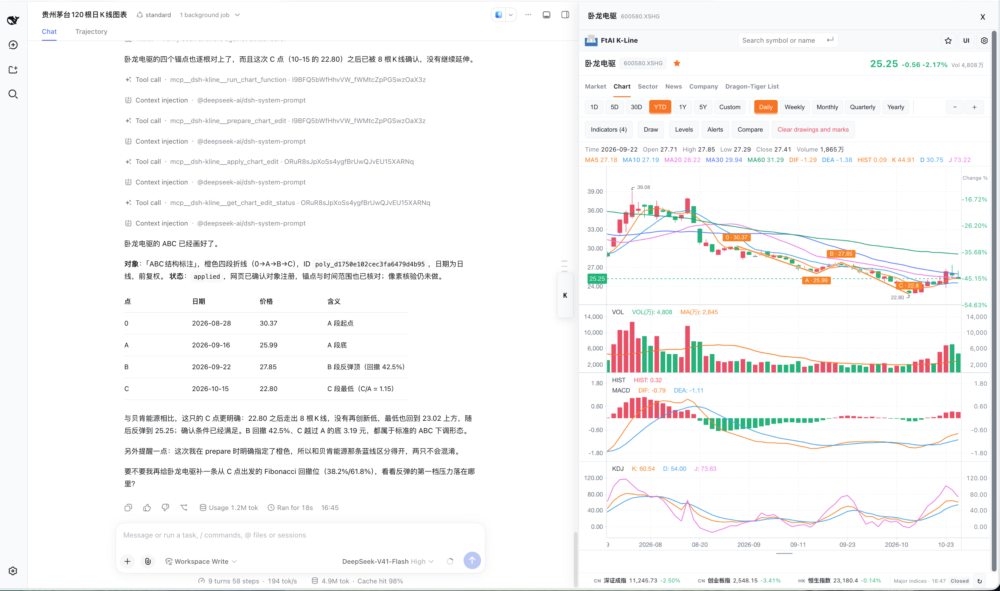](docs/images/natural-language-abc-wolong-2026-10-27.png)

### Continue by adding a descending channel

A follow-up request adds parallel channel boundaries after the host checks their anchors. The existing ABC labels remain on the same chart.

[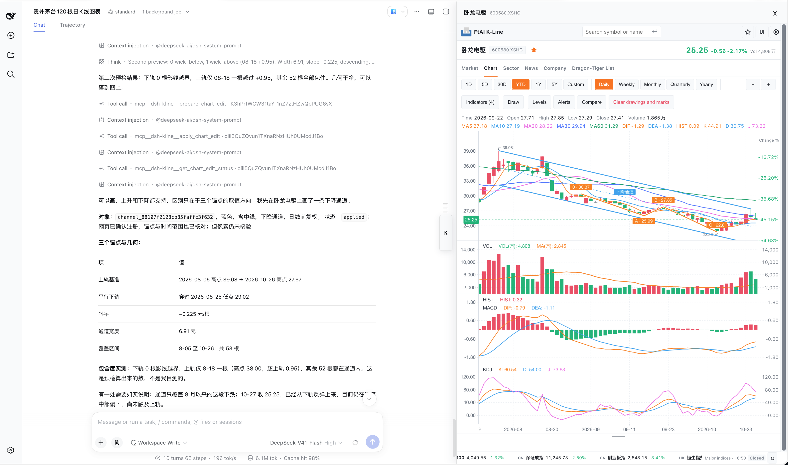](docs/images/natural-language-descending-channel-wolong-2026-10-27.png)

Example requests:

```text
Open Wolong Electric's daily chart. Verify a recent ABC swing candidate and draw it if it qualifies.
Add a descending channel to the same chart, keeping the ABC labels.
Draw the newest qualifying double bottom and explain its current state.
Show Nine Count for the latest 30 closed daily bars.
Make “Key support” blue and move it to 30.8.
```

An analysis request returns analysis. An explicit drawing request puts the result on the chart. Specified anchors and candidate choices take priority.

## Drawing workbench and price patterns

Open **Draw** → select a tool → **Draw now**. Use **Pick anchors manually** to select your own points and **Settings** to adjust parameters. Drawings appear directly, without a separate save step. Closing or collapsing the controls preserves them; **Clear** is inside the drawing panel.

### ABC labels and anchor selection

[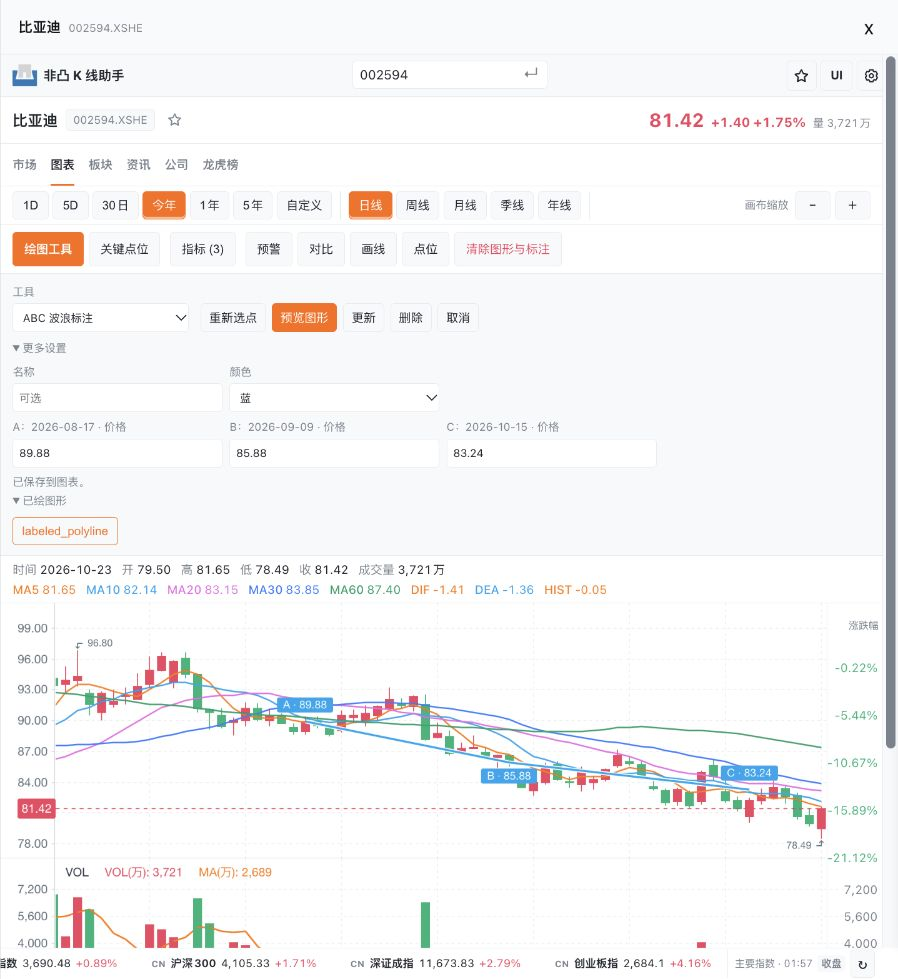](docs/images/abc-drawing-v0.5.0.jpg)

### Parallel channel

[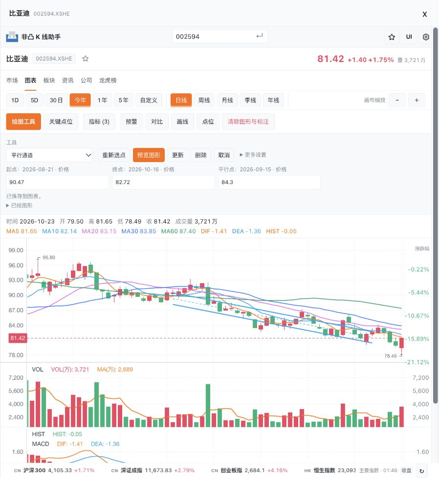](docs/images/channel-drawing-v0.5.0.jpg)

### Drawing workbench

[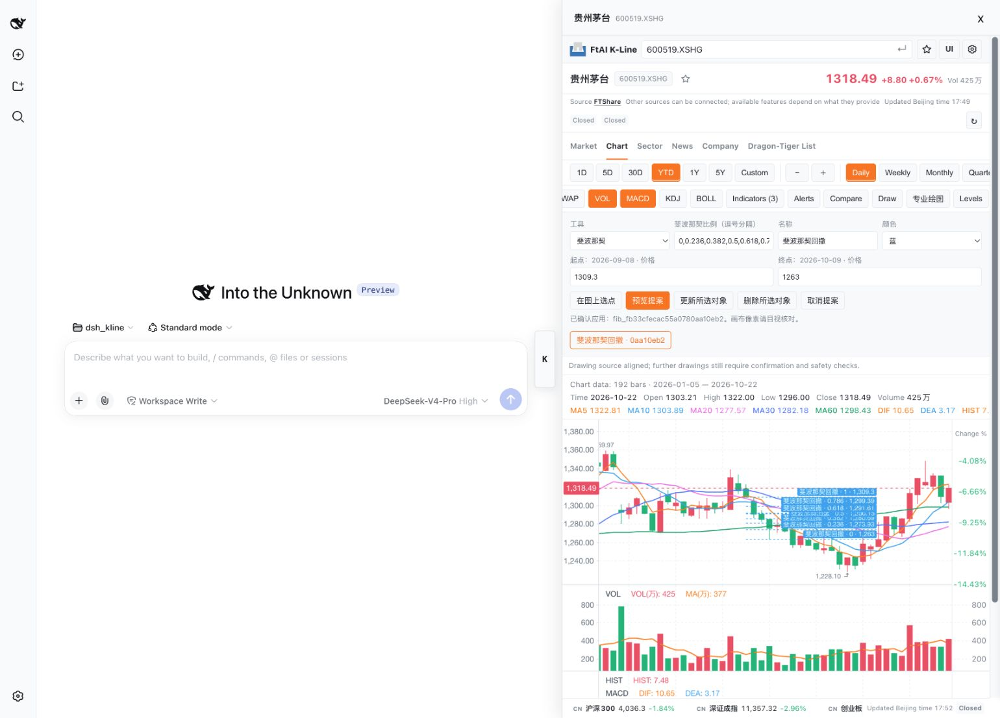](docs/images/drawing-workbench-v0.5.0.jpg)

### Range formation, breakout, and failure states

MSFT daily example: the range forms from August 28 to September 25, with an upward breakout confirmed on October 6. The chart shows its boundaries and actual confirmation date; subsequent prices do not enlarge the frozen range.

[](docs/images/platform-breakout-msft-v0.6.9.png)

Double tops/bottoms and head-and-shoulders patterns likewise show necklines and candidate, confirmation, or failure states. Nine Count displays individual counts; it does not include a full DeMARK 13 Countdown. See [pattern rules](docs/price-pattern-rules-v1.md).

### Workspace and chart entry points

[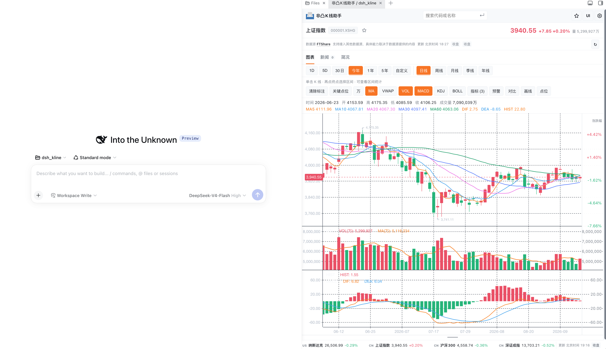](docs/images/dsh-kline-tab-workspace.png)

These real captures preserve different stages of the project. The ABC, channel, and earlier workbench images show historical interfaces; current button names and direct drawing behavior are described above. Click an image for its original dimensions.

## Market overview and chart comparison

### Put comparison lines in the main candlestick chart

Search for stocks, indices, or ETFs and overlay their price-performance lines behind the main chart. The primary symbol retains its candles and indicators. Hide or remove comparison lines independently.

[](docs/images/main-chart-comparison-v0.6.9.png)

*Lines use a common normalization baseline to compare cumulative percentage changes. They do not compare raw prices across symbols or calculate technical indicators for the comparison lines.*

### Market overview

Browse major A-share, Hong Kong, and US indices, sector rankings, and unusual-trading lists. Select a symbol to continue in its chart and research panels.

[](docs/images/market-overview-v0.6.9.png)

The market, comparison, and MSFT platform captures preserve native Retina pixels as lossless PNGs. Prices are snapshots from capture time.

## Levels, review, and research

### Support and resistance

Use **Levels** to analyze reference prices, add custom levels, and draw them on the current chart.

[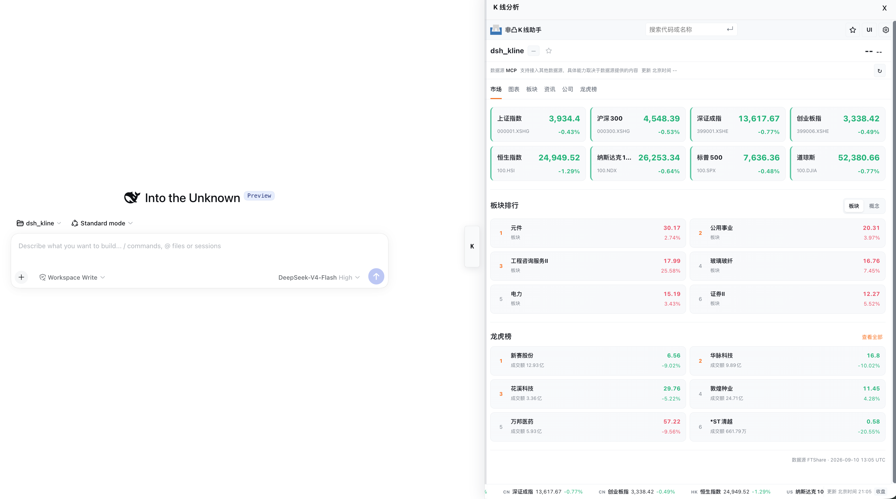](docs/images/kline-support.png)

### Interval review

Inspect interval returns and drawdown alongside the chart.

[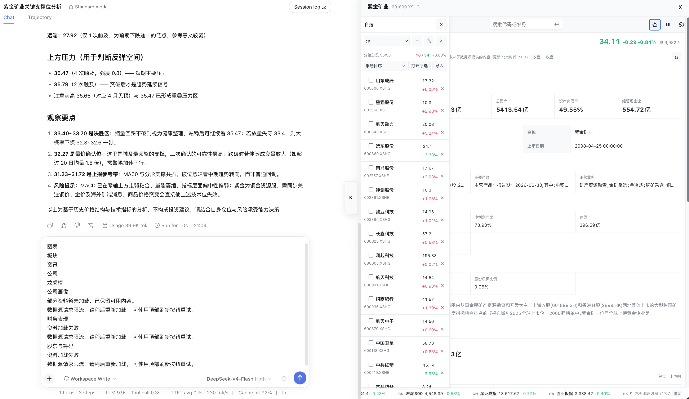](docs/images/kline-range-stats.png)

### News and company information

Read symbol news, company information, and research panels next to the chart. Coverage depends on the source and permissions.

[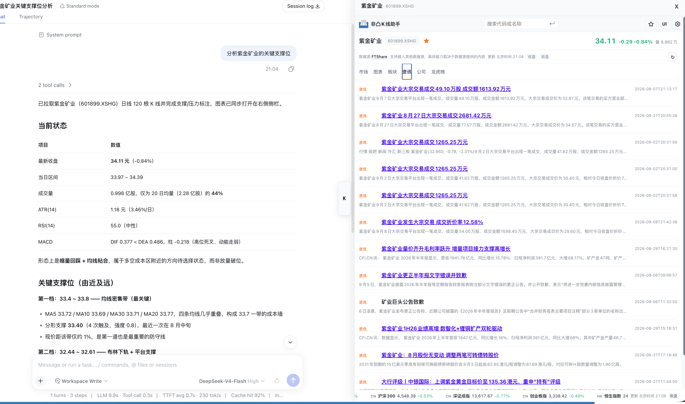](docs/images/kline-news.png)

## Install

Supports macOS, Linux, and native Windows. First launch downloads dependencies and may take several minutes.

### DeepSeek Harness

Install a working DSH Web host and **Python 3.11+**, then run:

```bash
dsh plugin --profile web add @ftshare-lab/dsh-kline@0.6.10
```

GitHub installation is also available:

```bash
dsh plugin --profile web add github:FTShare-Lab/dsh_kline
```

You can also find `dsh_kline` in the plugin marketplace. Its version and download information depend on catalog synchronization. See the [npm package](https://www.npmjs.com/package/@ftshare-lab/dsh-kline) for the published version; downloads are not unique installations.

[](docs/images/dsh-market.png)

After enabling it, click **K** or request analysis in chat. Newer DSH versions provide native right-sidebar tabs without Better Sidebar. Choose **UI → Workspace tab**, or continue using the classic K sidebar. v0.6.10's native auto-open was tested on DSH 0.2.1-rc.5, a prerelease host.

### Codex

Install a plugin-capable Codex, Git, **Node.js 22.19+**, and **Python 3.11+**:

```bash
codex plugin marketplace add FTShare-Lab/dsh_kline --ref main
codex plugin add ft-kline@ftshare
```

Reopen Codex and ask “Open China Merchants Bank's daily chart.” FTShare is this project's public GitHub plugin source.

| Host | Interactive chart and manual drawing | Chat-driven drawing | Quotes and structured analysis |
| --- | --- | --- | --- |
| DSH Web | Yes | Yes | Yes |
| Codex Desktop | Inside an App card | Yes | Yes |
| Codex CLI | No canvas | No chart writes | Yes |

See the [complete guide](docs/guide.en.md) for pinned archives, updates, migration, and startup troubleshooting.

## Data and scope

- **Sources:** FTShare can be configured and tested under Settings → Data source. Without a key, selected A-share, Hong Kong, US, and index historical daily sources may be available; coverage depends on the public provider.
- **Permissions and periods:** minute bars, news, and company information depend on the source and permissions. Automatic drawing, patterns, and Nine Count currently use loaded, closed daily bars for A-share, Hong Kong, and US stocks.
- **Editing:** drawings use real candles in the current chart. Unknown sources, expired results, or ambiguous active views stop edits with an explanation. Dragging anchors and undo are not currently supported.
- **Retention:** DSH watchlists and groups persist across conversations. Codex charts, watchlists, and temporary App keys remain in the current connection's memory and do not inherit DSH settings. Drawing recovery across service restarts is not guaranteed.

Market data may be delayed. Patterns and counts support research and review, without guaranteed trading returns. See [key-less coverage](docs/anonymous-market-support.md) and [free Hong Kong/US daily sources](docs/free-foreign-daily.md).

## Historical interface and original screenshots

<details>
<summary>Expand all early screenshots and original first captures</summary>

These images appeared in earlier READMEs and retain their original files and dimensions. They document the project's history; current interfaces and workflows are described above.

### Early desktop chart

[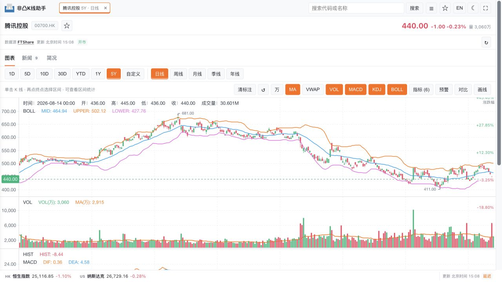](docs/images/chart-desktop.jpg)

### Early mobile layout

[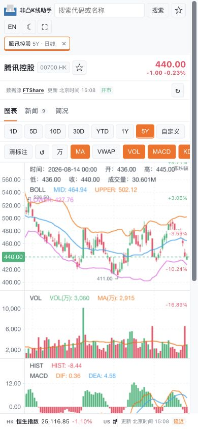](docs/images/chart-mobile.jpg)

### Early support and resistance chart

[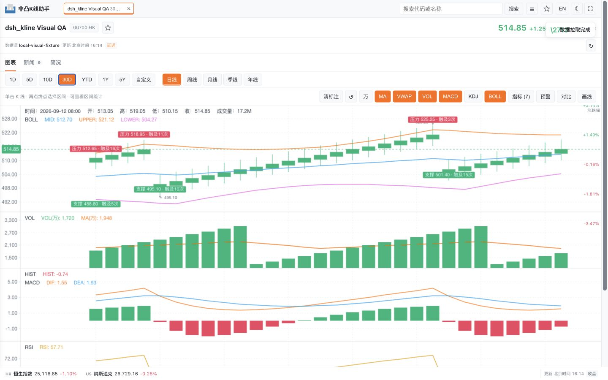](docs/images/chart-support-resistance.jpg)

### Host conversation and analysis entry

[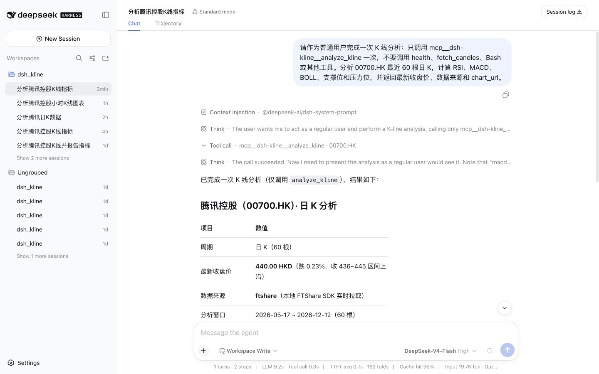](docs/images/harness-analyze-kline.jpg)

### Early sidebar

[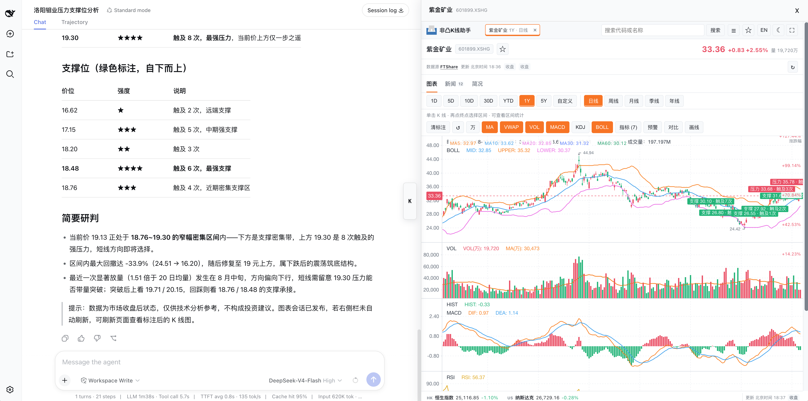](docs/images/dsh-sidebar.png)

### Original market capture

[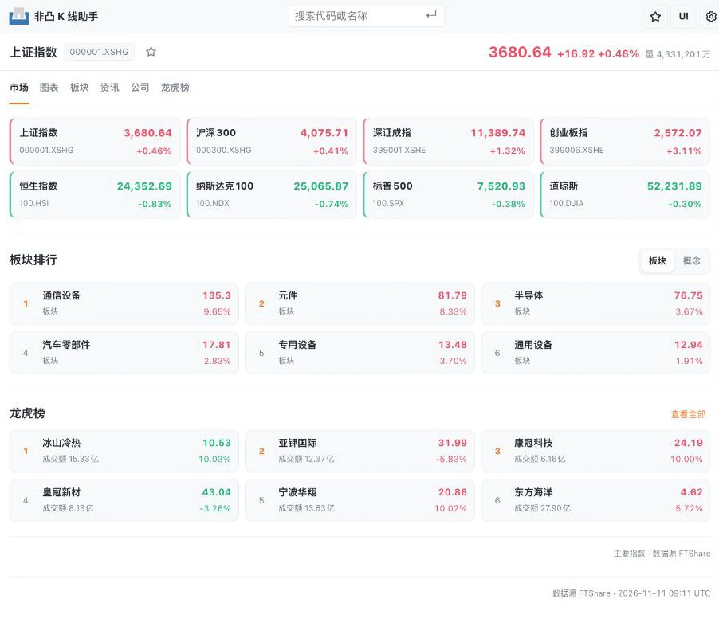](docs/images/market-overview-v0.6.9.jpg)

### Original comparison capture

[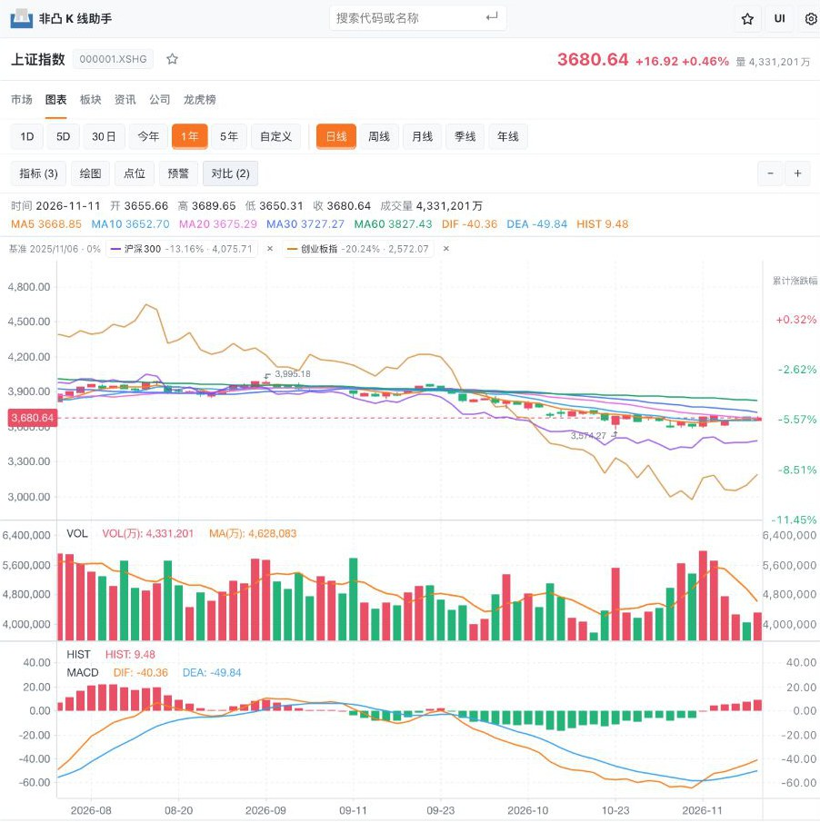](docs/images/main-chart-comparison-v0.6.9.jpg)

### Original platform breakout capture

[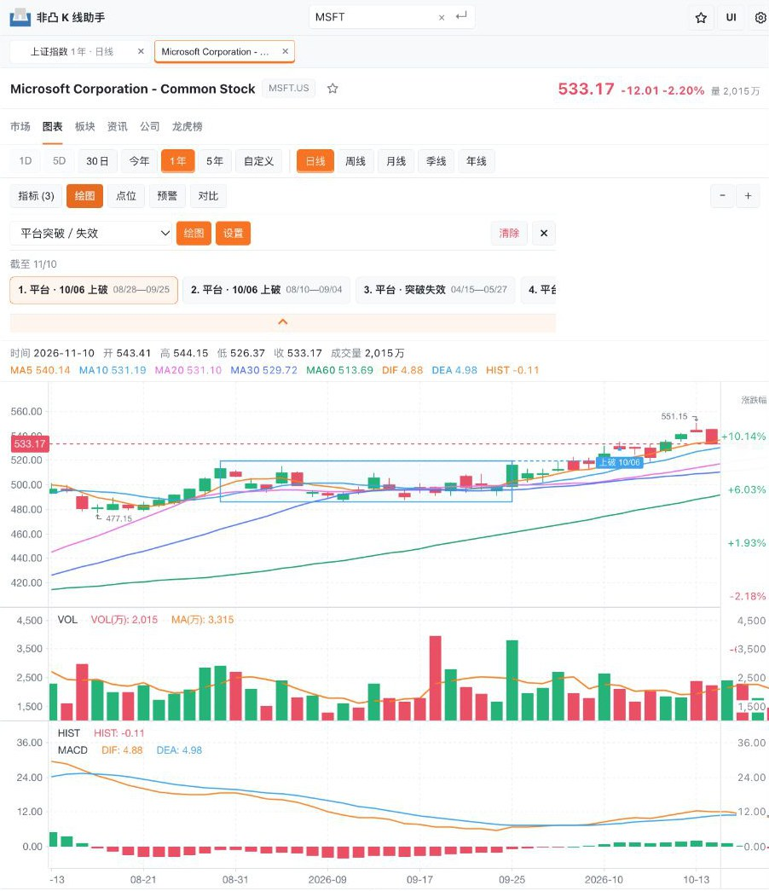](docs/images/platform-breakout-msft-v0.6.9.jpg)

</details>

## Documentation

| Topic | Link |
| --- | --- |
| Install, updates, keys, troubleshooting | [Complete guide](docs/guide.en.md) |
| Automatic drawing and extension | [Shared drawing architecture](docs/automatic-drawing.md) |
| Pattern definitions and real samples | [Rules](docs/price-pattern-rules-v1.md) · [Samples](docs/price-pattern-samples-v1.md) |
| Technical functions and advanced annotations | [Function and drawing coverage](docs/chart-functions.md) |
| Host and provider integration | [Embedding](docs/embedding.md) · [Provider adaptation](docs/provider-adaptation.md) |
| Releases and acceptance | [Changelog](CHANGELOG.md) · [v0.6.10 release notes](docs/release-notes-v0.6.10.md) · [Acceptance](docs/release-acceptance-v0.6.10.md) |

[MIT License](LICENSE) · [Frontend provenance](PROVENANCE.md) · [GitHub Releases](https://github.com/FTShare-Lab/dsh_kline/releases)
