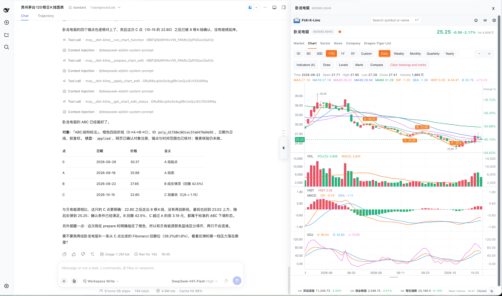
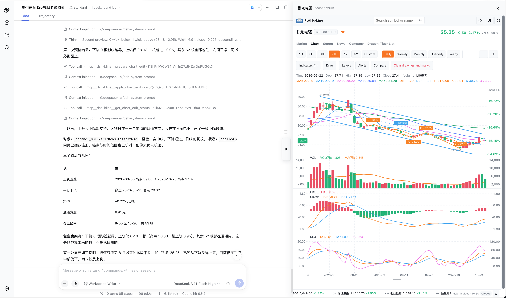
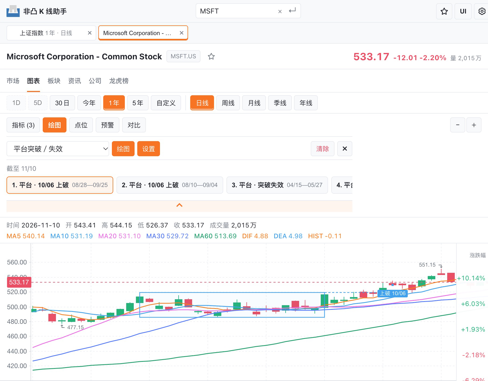
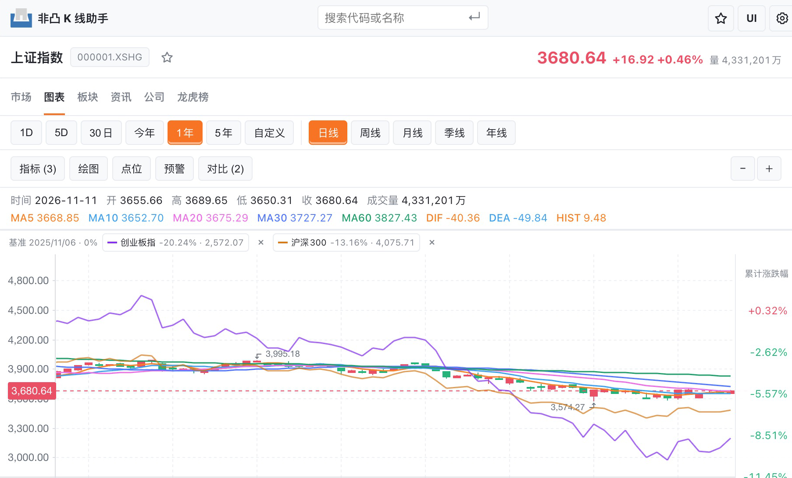
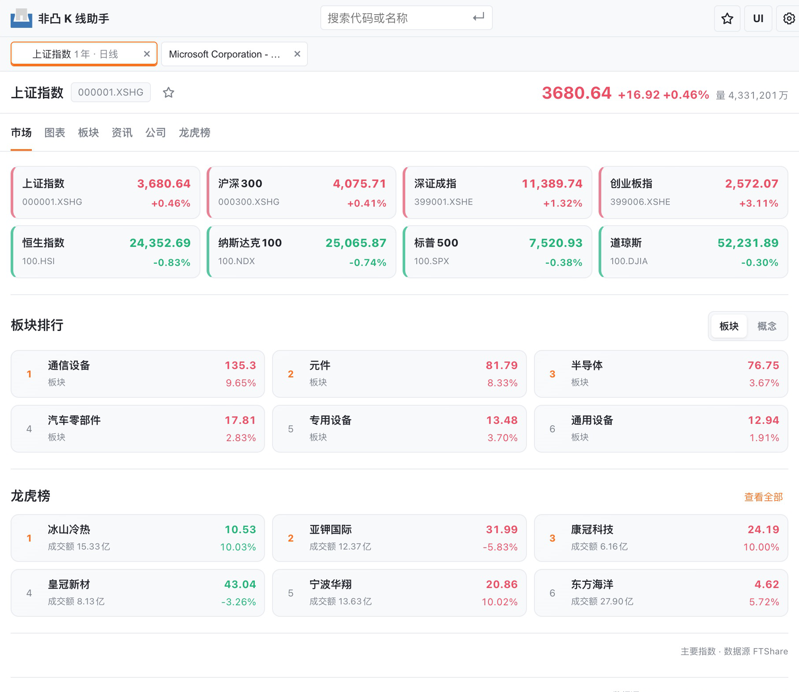
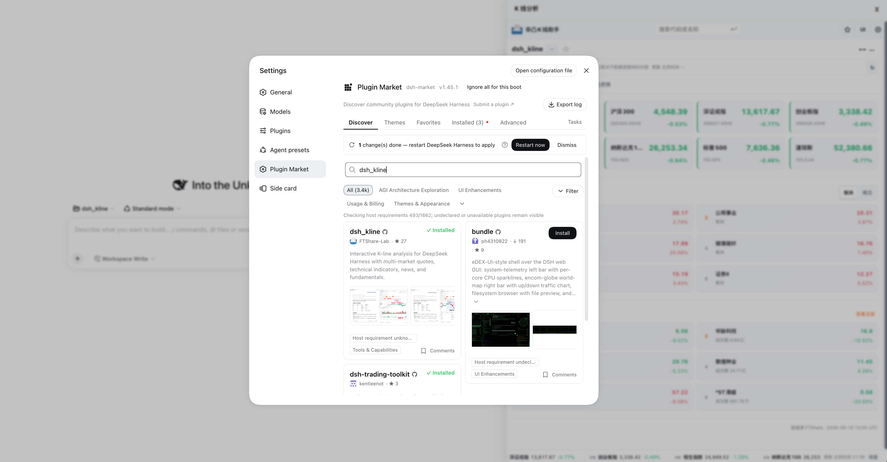

# 非凸 K 线助手 · FT K-Line

在 **DeepSeek Harness** 与 **Codex** 中查看行情，用自然语言分析、绘图和继续修改，也可以亲自在图上选点。

简体中文 · [English](README.en.md)

[](https://github.com/FTShare-Lab/dsh_kline/actions/workflows/install.yml) [](https://www.npmjs.com/package/@ftshare-lab/dsh-kline) [](https://github.com/FTShare-Lab/dsh_kline/releases) [](LICENSE)

[绘图清单](#支持哪些绘图) · [ABC 与通道实测](#自然语言绘图实测) · [绘图工作台](#绘图工作台与价格形态) · [大盘与对比](#大盘与主图对比) · [安装](#安装) · [文档](#文档)

当前发布版本 **v0.6.10**，npm 包名 **`@ftshare-lab/dsh-kline`**。图形直接显示，关闭工具面板后保留；用户可切换候选、继续修改或清除。

## 支持哪些绘图

对话和图表面板使用同一套绘图能力。自动绘图以**当前已加载的最近已收盘日线**为准，默认显示最新合格候选；也可以指定候选、日期和点位。

| 绘图工具 | 自动绘图 | 手动选点与自然语言操作 |
| --- | --- | --- |
| **水平线** | 查找近期高点／低点作为价位候选 | 指定价格，或点选 K 线；可作为支撑、压力或自定义价位 |
| **趋势线** | 查找近期符合条件的两点走势 | 指定两个时间与价位，创建或调整线段 |
| **平行通道** | 查找近期通道候选 | 选择三个锚点，调整边界及中线样式 |
| **平台框／箱体** | 查找符合边界接触与漂移条件的近期区间 | 框定时间和上下边界，调整名称、颜色及填充 |
| **斐波那契回撤** | 从近期波段寻找锚点 | 指定波段起终点及回撤比例，整组修改或删除 |
| **ABC 波段／ABC 浪标注** | 查找符合几何条件的 0／A／B／C 波段候选 | 自选锚点，或让宿主核对后落图；可单独修改指定点 |
| **双顶** | 识别顶部结构及后续状态 | 手动指定结构锚点，仍需满足识别规则 |
| **双底** | 识别底部结构及后续状态 | 手动指定结构锚点，仍需满足识别规则 |
| **头肩顶** | 识别双肩、头部与颈线 | 手动指定五个结构锚点，并校验形态 |
| **头肩底** | 识别反向头肩结构与颈线 | 手动指定五个结构锚点，并校验形态 |
| **平台突破／失效** | 冻结平台边界，标示待确认、突破确认及失效状态 | 自选区间使用普通平台框；状态由行情分析得出 |
| **九转计数** | 逐根显示上涨／下跌 1–9；行情变化后更新 | 由行情自动计数，可调整显示范围与样式 |

**ABC 是波段几何候选与折线标注，不等于完整艾略特波浪识别。** 价格形态与九转当前支持 A／港／美股已收盘日线；找不到合格候选时会说明原因，不强行绘制。

### 指标与更多标注

- **指标面板：** SMA、EMA、VOL、MACD、KDJ、RSI、BOLL、ATR、VWAP。SMA／EMA／BOLL 也支持由宿主计算并添加为独立指标对象。
- **自然语言标注：** 文字、数值、箭头与菱形图标、带标签折线；支持按名称或指定点继续修改。
- **进阶工具接口：** 条件价格序列、价带与条件柱线。具体输入、显示范围及限制见[函数与绘图说明](docs/chart-functions.md)。
- **图形管理：** 创建、改名、改色、更新锚点、删除；同一张图可叠加多个对象。201 个 TA-Lib 函数可查询计算，只有已接入的图形与指标支持落图。

## 自然语言绘图实测

### ABC 候选：核对锚点后画到图上

DeepSeek 核对卧龙电驱日 K 的 0／A／B／C 四个锚点，再通过插件绘制。完整截图同时保留了左侧对话与右侧实际图形。

[](docs/images/natural-language-abc-wolong-2026-10-27.png)

### 在同一张图上继续添加下降通道

继续提出绘图请求，宿主核对通道锚点后添加平行边界，原有 ABC 标注保留。

[](docs/images/natural-language-descending-channel-wolong-2026-10-27.png)

以上两张为 2026-10-27 的完整实测截图，保留当时的对话和界面。点击图片可查看原图；当前绘图操作见下文。

可以这样提出需求：

```text
打开卧龙电驱日 K，核对最近一个 ABC 波段候选，符合条件就画出来。
在同一张图上添加下降通道，保留已有 ABC 标注。
找最近一个符合规则的双底并画出来，说明现在处于什么状态。
显示最近 30 根已收盘日线的九转计数。
把“关键支撑”改成蓝色，并移到 30.8 元。
```

请求“分析”时返回分析；明确请求“画出来”时直接绘制。用户指定点位或候选时，优先使用其选择。

## 绘图工作台与价格形态

点击 **绘图** → 选择工具 → **绘图**。需要自行指定锚点时使用 **手动选点**，通过 **设置** 调整参数；图形直接展示，无需另行保存。关闭或收起面板不会删除图形，**清除** 位于绘图面板内。

### 箱体形成、突破与失效状态

微软日 K 实例：08/28—09/25 形成平台，10/06 确认上破。图上展示箱体边界与实际确认日期；后续行情不会扩大已经冻结的箱体。

[](docs/images/platform-breakout-msft-v0.6.9.png)

双顶／底、头肩顶／底同样显示颈线及候选、确认、失效等状态。九转显示逐根计数，基础九转不包含完整 DeMARK 13 Countdown。定义与适用范围见[形态规则](docs/price-pattern-rules-v1.md)。

## 大盘与主图对比

### 把对比折线放进 K 线主图

搜索添加个股、指数或 ETF，将其走势作为背景折线叠加在主图中。主标的继续显示蜡烛图与指标，对比线可以分别隐藏或移除。

[](docs/images/main-chart-comparison-v0.6.9.png)

*对比线按共同基准归一化，比较累计涨跌幅；不直接比较不同标的的绝对价格，也不为对比线计算技术指标。*

### 大盘概览

浏览 A／港／美主要指数、板块排行和龙虎榜，点击标的进入图表，继续查看行情与资料。

[](docs/images/market-overview-v0.6.9.png)

大盘、主图对比与微软平台三张新图保留原生 Retina 像素，以无损 PNG 展示。行情是截图时的快照。

## 点位、复盘与资讯

| 功能 | 可以做什么 |
| --- | --- |
| **支撑与压力** | 在「点位」中分析参考价位、手动添加价位，并画在当前图上 |
| **区间复盘** | 查看指定区间的涨跌、回撤等统计，结合图表检查走势 |
| **资讯与公司资料** | 在行情旁查看新闻、公司资料与研究入口，覆盖取决于来源与权限 |
| **自选与分组** | 收藏、分组、排序、导入和批量打开标的；DSH 支持跨对话保留 |

## 安装

支持 macOS、Linux 和原生 Windows。首次启动需要联网准备依赖，可能耗时数分钟。

### DeepSeek Harness

先安装可用的 DSH Web 和 **Python 3.11+**，然后执行：

```bash
dsh plugin --profile web add @ftshare-lab/dsh-kline@0.6.10
```

也可使用 GitHub 安装：

```bash
dsh plugin --profile web add github:FTShare-Lab/dsh_kline
```

插件市场中搜索 `dsh_kline` 也可安装；市场的版本与下载数据随其目录同步。npm 当前版本见[包页面](https://www.npmjs.com/package/@ftshare-lab/dsh-kline)，下载量不代表独立安装人数。

[](docs/images/dsh-market.png)

启用后点击右侧 **K**，或直接在对话中请求分析。新版 DSH 自带原生右侧标签，无需安装 Better Sidebar；在 **UI → 工作台标签** 中切换，经典 K 侧栏仍可使用。v0.6.10 已验证 DSH 0.2.1-rc.5 的原生自动开图；该宿主属于预发布版本。

### Codex

先安装支持插件的 Codex、Git、**Node.js 22.19+** 和 **Python 3.11+**：

```bash
codex plugin marketplace add FTShare-Lab/dsh_kline --ref main
codex plugin add ft-kline@ftshare
```

重新打开 Codex，请求「打开招商银行日 K」。FTShare 是本项目维护的公开 GitHub 插件源。

| 宿主 | 交互图表与手动绘图 | 自然语言绘图 | 行情与结构化分析 |
| --- | --- | --- | --- |
| DSH Web | 支持 | 支持 | 支持 |
| Codex 桌面版 | 在应用卡片内使用 | 支持 | 支持 |
| Codex CLI | 不提供画布 | 不落图 | 支持 |

固定版本归档、更新、旧安装迁移与启动排障见[完整指南](docs/guide.md)。

## 数据与适用范围

- **行情来源：** 可接入 FTShare；在「设置 → 数据源」配置并测试 Key。无 Key 时可尝试部分 A 股、港美股历史日 K 和指数备用行情，覆盖与可用性取决于公开源。
- **权限与周期：** 分钟线、新闻和公司资料取决于来源与权限。自动绘图、价格形态与九转当前使用已加载的 A／港／美股已收盘日线。
- **修改边界：** 绘图使用当前图真实 K 线。数据来源不明、结果过期或活动视图存在歧义时，会停止修改并说明原因；鼠标拖拽改点与撤销暂不支持。
- **保存范围：** DSH 自选与分组跨对话保留。Codex 图表、自选及应用内临时 Key 保存在当前连接内存中，不继承 DSH 配置；绘图不保证跨服务重启恢复。

行情可能延迟。形态与计数用于研究和复盘，不保证交易收益。数据覆盖见[无 Key 支持范围](docs/anonymous-market-support.md)与[港美股免费日线](docs/free-foreign-daily.md)。

## 文档

| 主题 | 入口 |
| --- | --- |
| 安装、更新、Key、故障排查 | [完整指南](docs/guide.md) |
| 自动绘图流程与扩展 | [共享绘图骨架](docs/automatic-drawing.md) |
| 形态定义与真实样本 | [规则](docs/price-pattern-rules-v1.md) · [样本](docs/price-pattern-samples-v1.md) |
| 技术函数与进阶标注 | [函数与绘图范围](docs/chart-functions.md) |
| 宿主与数据源接入 | [面板嵌入](docs/embedding.md) · [数据适配](docs/provider-adaptation.md) |
| 版本与验收 | [更新日志](CHANGELOG.md) · [v0.6.10 发布说明](docs/release-notes-v0.6.10.md) · [验收记录](docs/release-acceptance-v0.6.10.md) |

[MIT License](LICENSE) · [前端来源](PROVENANCE.md) · [GitHub Releases](https://github.com/FTShare-Lab/dsh_kline/releases)
