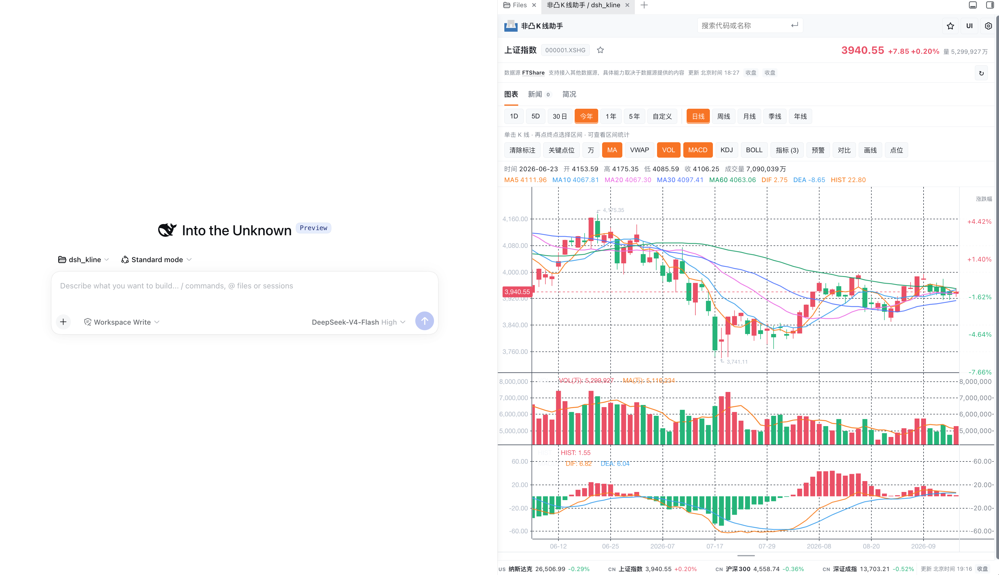
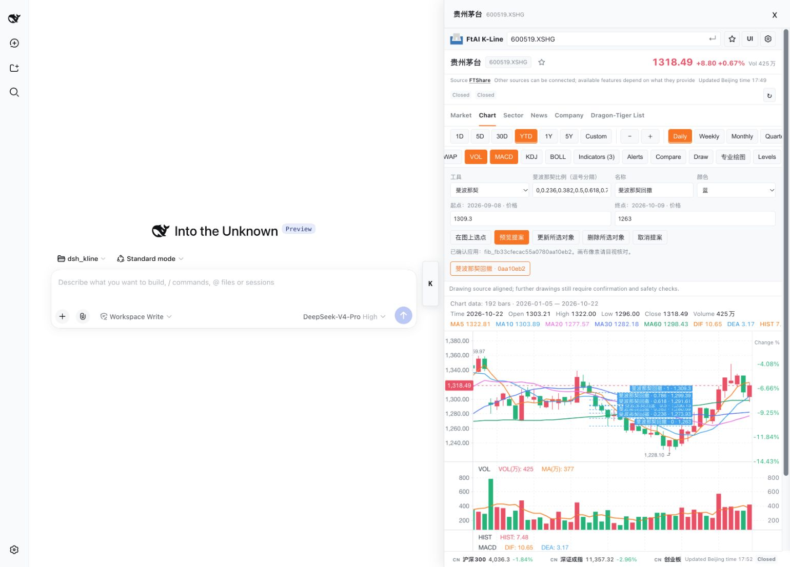
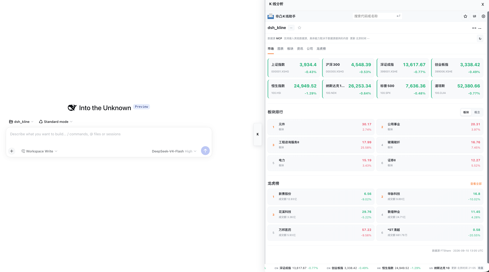
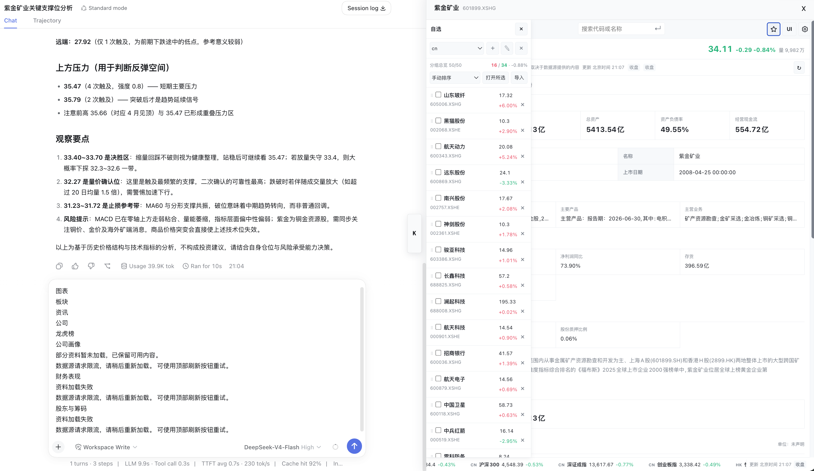
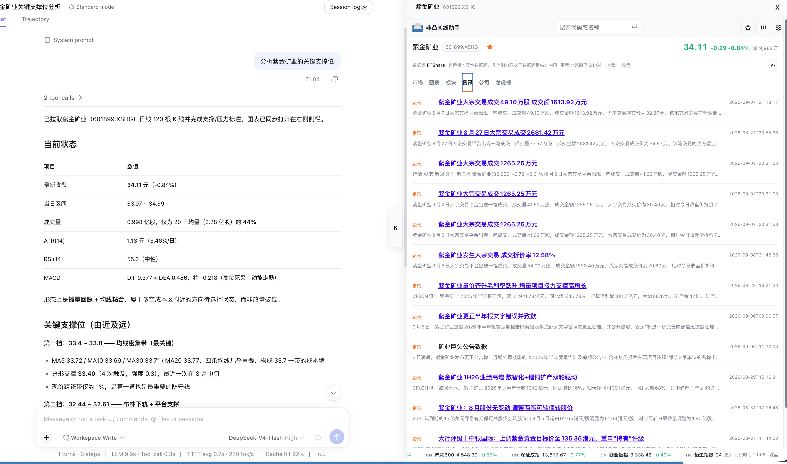
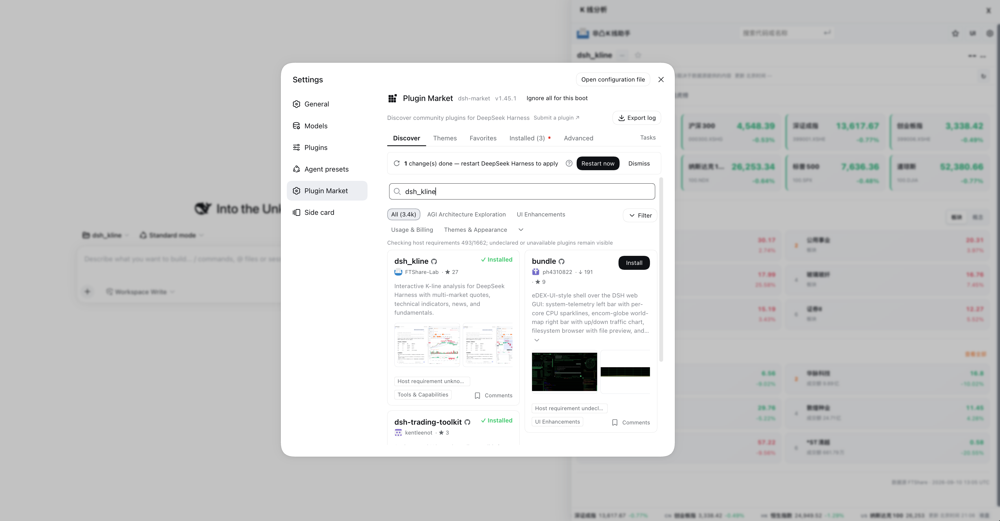

# 非凸 K 线助手 / dsh_kline

简体中文 | [English](README.en.md)

在 DeepSeek Harness 里，把一句自然语言变成可核对的技术分析图形；也可以打开专业绘图工作台，自己选点、改色、续改。两种入口共用当前图和同一批受保护对象。

> 行情与技术分析用于研究和学习，不构成投资建议。

## 它能帮你做什么

- **一句话开始分析**：直接说“看看紫金矿业最近一个月趋势”或“分析英伟达的 MACD 和 RSI”。
- **自己动手看图**：打开 K 线工作台，搜索名称或代码，随时切换日、周、月、季、年和可用的分钟周期。
- **看清趋势与信号**：支持 MA、成交量、MACD、KDJ、RSI、BOLL、ATR、VWAP 等常用指标。
- **画出自己的分析**：工作台可选择 SMA、EMA、BOLL，以及水平线、趋势线、平行通道、平台框、斐波那契和 ABC 波浪标注；预览提案后再确认落图。
- **让 AI 继续修改**：宿主可按自然语言调用同一绘图链，按稳定 ID 改价、改色、修改锚点或删除；绘图计算和应用结果分开核对。
- **查询标准技术函数**：TA-Lib 0.8.2 的 201 个函数可在当前图只读查询和计算；并非 201 个都能绘图。第一期只有 SMA、EMA、BBANDS 的受控结果可直接落图。详见[函数说明](docs/chart-functions.md)。
- **寻找价格区域**：一键分析支撑位和压力位；也可以自己画水平价位线、添加备注，并在本机保存。
- **比较与复盘**：叠加指数或标的、框选两个时间点查看涨跌、振幅、回撤和成交统计。
- **补充研究信息**：在“市场、板块、资讯、公司、龙虎榜”中浏览指数、板块排行、资金异动、新闻、公司画像、财务与股东信息。
- **建立自己的关注列表**：收藏标的、建立或重命名分组、排序、导入或批量打开；自选会作为你的用户级数据跨对话保留。

## 预览











## 开始使用

### 1. 安装并启用

在 DeepSeek Harness 的插件市场搜索 `dsh_kline`。如果市场目录还没有刷新，可以直接从 GitHub 安装：

```bash
dsh plugin --profile web add github:FTShare-Lab/dsh_kline
```

首次启动会自动准备所需运行环境。以后有新版本时，在插件市场或设置页更新即可。

插件支持 macOS、Linux 和原生 Windows。用户需要先安装可运行的 DSH Web，以及 Python 3.10 或更高版本；Windows 推荐使用 [python.org](https://www.python.org/downloads/windows/) 安装包并启用 Python Launcher。插件不要求 Git Bash 或 WSL。首次启动的依赖安装日志位于用户缓存目录下的 `dsh_kline/bootstrap.log`；Windows 默认为 `%LOCALAPPDATA%\dsh_kline\bootstrap.log`。



### 2. 任选一种入口

**和 AI 对话**：在对话中提出需求，例如：

- `调取紫金矿业的 K 线，看看最近一个月走势`
- `分析腾讯控股日 K，标注支撑位和压力位`
- `查看英伟达最近一个月的成交量、MACD 和 RSI`
- `这只股票最近有什么新闻和基本面变化？`
- `在当前图画1300元的蓝色支撑线，叫关键支撑；之后把它改成绿色`
- `请先给出下降通道的三个锚点和偏离，再等我确认是否落图`

**直接打开工作台**：点击右侧 K 按钮，或在支持工作台 Tab 的界面从 `+` 菜单选择 **非凸 K 线助手 / dsh_kline**。输入股票名称或代码即可开始，不需要记住交易所后缀。

两种入口可操作同一张当前图中的新绘图对象；也可以在图表工具栏打开 **专业绘图**，从精选工具中点选 K 线锚点、预览、确认。每个对话各自保存图表状态，避免串图；自选与分组属于用户级数据，跨对话保留。

## 图表怎么用

1. 用顶部搜索框输入标的名称或代码。
2. 选择时间范围和 K 线周期；分钟线是否可用取决于数据权限和市场。
3. 开启需要的指标，拖动、缩放或使用十字线查看细节。
4. 点击 **关键点位** 查看支撑和压力；点击 **专业绘图** 选择精选工具，图上点选锚点或输入参数，核对提案后确认。旧 **画线** 和 **点位** 仍可使用。
5. 依次点击两根 K 线，查看这段区间的涨跌、振幅、回撤与成交统计。
6. 点击名称旁的星标，把标的放进自选。

如果界面提供 **UI** 入口，可按习惯选择自动、独立侧栏或工作台 Tab。自动模式会使用当前 Harness 能提供的最佳界面；没有工作台 Tab 框架时，仍可正常使用右侧 K 线侧栏。

## 绘图：对话与工作台共用一个对象流程

在当前已核对来源的图表中，宿主可根据自然语言调用插件的计算、准备、应用和状态核对；工作台则提供可见的手动选择和预览。精选范围包括：

- 水平线：指定价位、名称、颜色。
- 两点趋势线：连接已有 K 线的两个时间 / 价格锚点。
- 平行通道：三点确定上升、下降或水平通道，可开关中线。
- 平台矩形框：指定时间和上下价格边界，可开关淡色填充。
- 斐波那契回撤：两点及比例作为一个对象管理；价位由插件按价格公式计算。
- ABC 标注：连接用户指定的 A/B/C 锚点，可按点名续改；**不是自动识浪**。
- SMA、EMA 单线与 BOLL 三轨：TA-Lib 结果可在明确要求后作为独立主图对象落图，不等于切换现有指标开关。

例如：

- `在31.2元画蓝色水平线，叫基础支撑`
- `把基础支撑移到30.8元，其他图形不动`
- `把这两天的最低价连成绿色趋势线`
- `找一段下降通道，先告诉我三个锚点和明显偏离，确认后再画`
- `框出这段整理区间；把框的上沿改到31.2；只删除这个框`

宿主 AI 负责理解、分析和选点；插件负责读取当前图、确定性测量、执行与反馈，
不内置另一套 AI，也不靠预置绘图 skill 回放。明确参数可直接执行；要求先提方案时，
确认前不绘制。宿主分析和解释可能出错，专业画线质量仍需使用者核对。

### 当前范围与限制

- 重点验收日线 / 周线。锚点必须对应当前已加载的真实 K 线，不会猜日期、吸附端点或自动取新行情补点。
- 支持蓝、绿、橙、红四种颜色。两点线和通道为有限区间，不自动延伸，不支持对数通道。
- 修改按稳定对象 ID 定位，绘图不重置行情、指标或可见范围；通道和平台框按创建周期隔离。
- 当前宿主运行期间，同一对话已确认图形可在网页刷新后恢复并继续修改；不同对话不共用绘图对象。
  返回对话恢复最后确认的绘图检查点，**不保证恢复离开前最后一次手动选择的周期、范围或视口**。
- 工作台支持表单与图上点选，已确认的新对象可由对话或工作台按 ID 续改；鼠标拖拽和撤销暂不支持。旧手动画线、自动标注与受保护对象分开管理。
- “清除以上三类”只清分析标注、手动画线和自定义点位，保留 AI 图形、指标与预警；删除 AI 图形请在对话中指定目标。
- 图形可能超出当前时间 / 价格可见区。对象核对和应用回执不等于屏幕像素核验，也不证明供应商行情真值。
- 来源过期、周期 / 复权不明、多个活动视图或结果未知时停止修改；不要自动重做未知操作。
  完整服务重启后的旧图编辑和完整异常自动恢复尚不支持。
- 分钟功能取决于来源与权限，本版不承诺全部分钟 / 市场 / 操作组合。通道、平台、ABC 均不代表自动专业形态识别；缠论未接入。201 个 TA-Lib 函数大多只读，不承诺全部可绘制。

### 给宿主与开发者

当前图修改使用 `get_chart_context → prepare_chart_edit → apply_chart_edit → get_chart_edit_status`。
确认后重新读取当前观察，以原批准参数核对；`context_ref` 不是 `chart_session`。
只读 `preview_chart_channel` 提供几何 / 偏差核对，`verify_chart_drawings` 核对指定对象参数；
二者不选点、不评判专业形态、不代替绘图授权。旧的分类型工具是快照接口，不应绕过当前图应用协议。

运行 `pnpm build:sidebar` 和 `pnpm test` 验证构建与全部 Node / Python 回归。
本版范围、证据和待完成发布门槛见[v0.5.0 候选验收说明](docs/release-acceptance-v0.5.0.md)。
首次自动准备依赖需要网络，耗时取决于网络和本机环境。

## 行情与数据源

默认可接入 FTShare。配置 API Key 后，插件会根据你的账户权限提供相应的行情、分钟线、新闻和公司资料能力；不同市场和套餐的可用范围可能不同。

普通 A 股当日1分钟、none不复权请求优先使用 FTShare 的实时一分钟数据；前 / 后复权请求（含qfq / hfq）使用携带匹配adjust_kind的历史接口，失败时不混入原始实时数据。指数、ETF 与多日分钟历史继续使用各自适用的历史接口；完整交易时段与缓存复权隔离规则不变。此分流不等于对供应商复权价格正确性的独立验证。
分钟粒度随明确来源、重绘及工作区状态保留；元数据缺失或非法时仍为未知，不按K线时间间隔 / 界面标签猜测，也不继承上一标的粒度。来源未确认时继续禁止受保护绘图。

插件会按以下顺序复用 FTShare 凭据：当前 DSH 服务已注入的 `FTSHARE_API_KEY`、用户显式指定的 `FTSHARE_API_KEY_FILE`、DSH 的 FTShare 设置所保存的 Key，以及此前由本插件保存的本机凭据。也就是说，若你已把 Key 配给启动 DSH 的环境，插件会直接使用；仅安装 FTShare SDK、或把 Key 留在其他应用的私有配置中，并不会被自动读取。

DSH 中安装了 FTShare 设置插件时，宿主会把设置里的 Key 发布给 MCP 服务，插件在每次取数前重新读取，因此在设置页新增、更换或清除 Key 后无需重启 dsh；该 Key 由设置页管理，插件不会显示或清除它。

出于安全考虑，插件不会扫描 `.env`、shell 配置、钥匙串或其他应用的配置文件，也不会显示 Key 或文件路径。**设置 → 数据源** 会清楚标出当前来源；需要更换时，在“管理 FTShare 配置”中粘贴 Key 并测试连接，可选择仅本次使用，或保存到本机供下次启动加载。

主题和语言默认跟随 dsh 宿主，可在 **设置 → 主题/语言** 中改为手动选择；随时可切回“跟随宿主（默认）”。

没有配置 Key 时，部分公开行情与图表能力仍可使用。遇到数据延迟、收盘、权限不足或上游暂不可用，界面会说明实际原因和数据来源。

## 常见问题

**为什么找不到分钟线？**
分钟行情是否可用取决于标的市场、账户套餐和数据源当前支持范围。请先在“数据源”中测试连接；日、周、月等周期不受此限制。

**Windows 首次启动失败怎么办？**

先在终端执行 `py -3.10 --version`（更高版本也可以），确认 Python Launcher 能找到 Python。然后查看 `%LOCALAPPDATA%\dsh_kline\bootstrap.log`；如果 Python 安装在自定义位置，可在启动 DSH Web 前设置 `DSH_KLINE_PYTHON` 为 `python.exe` 的完整路径。DSH Web 本身的安装或 Windows sandbox 问题需要参考 DSH 官方文档。

**为什么两个对话显示不同的图？**
这是刻意设计：图表会绑定各自对话，避免 A 对话的分析覆盖 B 对话。需要在另一个对话查看时，直接搜索或重新发起分析即可。

**为什么同一标的的数据与其他平台略有不同？**
行情可能延迟，也会受复权方式、交易所口径、收盘状态和上游服务影响。商业、高频或对时效有严格要求的场景，请使用有相应授权与服务等级的数据源。

## 给 AI 与开发者

大多数场景只需调用 `analyze_kline`。插件还提供 `fetch_candles`、`search_symbols`、`calc_metrics`、`analyze_kline_rows`、`data_source_status`、`configure_ftshare`、`test_ftshare_connection` 和 `health`，用于原始数据、外部 OHLCV、配置与诊断；`market_pulse`、`market_board_detail` 和 `security_intelligence` 提供市场与标的情报；`get_watchlist`、`save_watchlist` 用于读取和保存自选分组。

FTShare 只是默认适配器，不是分析引擎的前提。调用方可以把自己的标准 OHLCV 数据交给 `analyze_kline_rows`，继续使用指标、关键点位、图表和工作台。接入说明见 [数据源适配指南](docs/provider-adaptation.md)。

### 由宿主提供 Python 运行环境

普通安装默认使用 `DSH_KLINE_RUNTIME_MODE=auto`，沿用现有的 Python/venv 选择和依赖准备流程。桌面应用、容器等宿主可在启动 DSH 前设置：

| 环境变量 | 含义 |
| --- | --- |
| `DSH_KLINE_PACKAGE_ROOT` | 可选的插件包根目录绝对路径；未设置时按原 profile 安装位置定位。 |
| `DSH_KLINE_PYTHON` | 宿主提供的 Python 解释器路径。 |
| `DSH_KLINE_RUNTIME_MODE` | `auto`（默认）或 `external`。 |

`external` 模式要求 Python 3.10+ 和所需依赖已经可用，只校验并启动服务，不创建 venv、不安装依赖、不回退到其他解释器；失败应由宿主修复。该模式不能与 `DSH_KLINE_VENV`、`--prepare-project` 或 `--bootstrap-runtime` 同时使用。`DSH_KLINE_DEFER_BOOTSTRAP` 在该模式下不触发后台安装。

宿主负责解释器、依赖搜索路径及隔离配置（例如 `PYTHONPATH`、`PYTHONNOUSERSITE` 或 Windows 嵌入式 Python 的 `._pth`），插件不推导宿主目录布局。需要动态端口时设置 `DSH_KLINE_CHART_PORT=0`。环境变量在 MCP patch 中显式转交，无需修改 DSH 核心；直接运行 Node 启动器时，插件根目录由启动器自身位置决定。

## 更新与许可

更新记录见 [Releases](https://github.com/FTShare-Lab/dsh_kline/releases)。本项目采用 [MIT License](LICENSE)，前端来源说明见 [PROVENANCE.md](PROVENANCE.md)。
