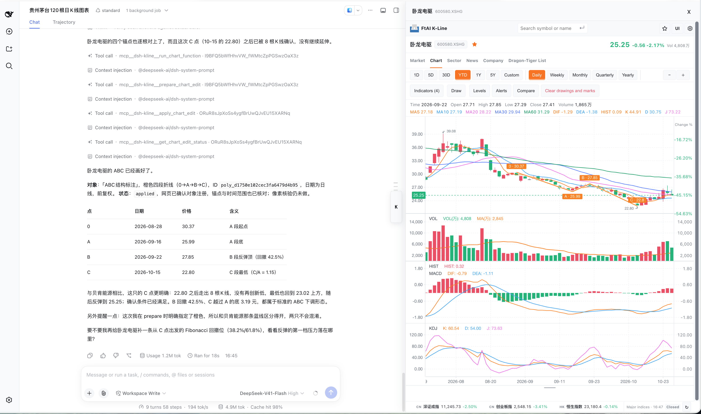
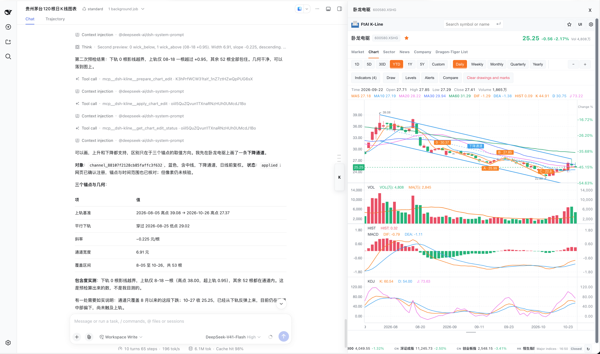

# Natural-language drawing examples

[Back to overview](../README.en.md)

These historical captures demonstrate chat-driven drawing; the current UI differs.

Live natural-language example: DeepSeek screened the watchlist for an ABC **candidate** in Wolong Electric, checked the four 0/A/B/C anchors against candles, and used the plugin to draw them. This unedited full-page capture shows the conversation, application result, and visible chart together. The host interprets the pattern; a rules-based candidate is not a verified Elliott-wave conclusion.

In the same chart, a follow-up natural-language request adds a descending channel. DeepSeek checks its three-anchor geometry and price deviations; the plugin applies it as a separate object while preserving the ABC labels. The lines are visible, but their trading relevance still requires independent judgment.

