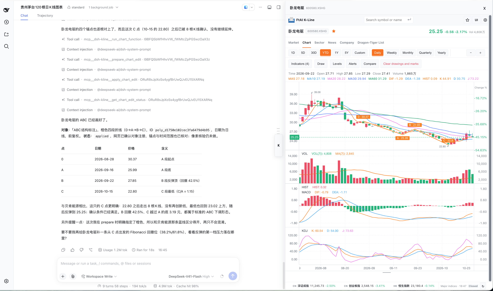
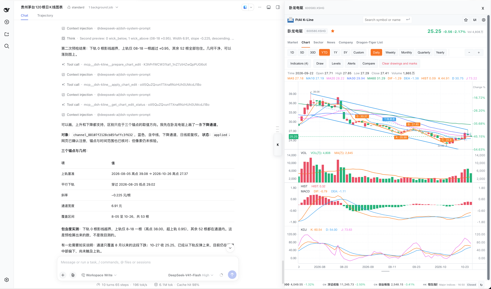

# 自然语言绘图实例

[返回首页](../README.md)

以下为历史版本实测，界面外观与当前候选版有差异。

自然语言实测：DeepSeek 从自选中筛出卧龙电驱的 ABC **候选**，逐根核对 0、A、B、C 四个锚点，再通过插件落图。同一张完整网页截图展示了对话、应用回执和右侧画布；画布上的折线与标签已实际可见。形态判断由宿主完成，规则筛查不等于专业波浪结论。

继续用自然语言在同一张图上添加下降通道：DeepSeek 核对三点几何与区间内的价格偏离，插件将通道作为独立对象落图；原有 ABC 标注仍保留。图上的线条可见，但通道是否具有交易参考价值仍需自行判断。

