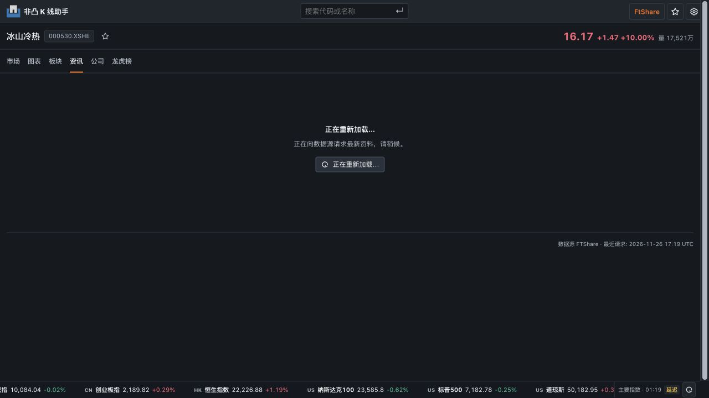
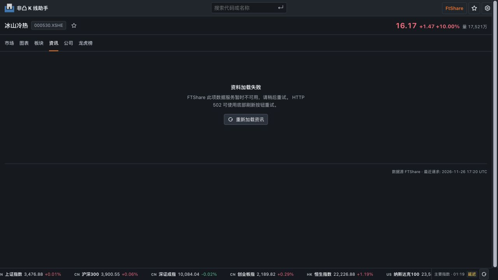

# v0.6.14 发布验收

本版针对资讯／公司资料刷新与错误反馈，基于 v0.6.13。

## 验证范围

- 强制刷新绕过预取缓存、有限等待、重复点击防护、加载状态和按钮恢复。
- 502、Key／权限、限流、超时、空结果、暂不支持、部分数据和请求恢复。
- 失败时保留已有内容与原成功时间，成功的空结果正常替换旧内容。
- DSH 与 Codex 共用前端、MCP App 忽略 AbortSignal 时的超时恢复，以及两种发行包。

## 实际服务限制

本地使用已有凭据，对冰山冷热及多只 A 股请求 FTShare 新闻语义搜索仍观察到 HTTP 502。有效凭据的鉴权对照与其他进阶数据接口可成功。这些结果只能确认受测账号的资讯调用失败，不能代替服务端日志定位或其他账号验证。

插件配置成功与新闻服务恢复是两项不同结果。页面恢复场景使用受控响应验证，并不表示实际 FTShare 新闻服务恢复。

## 发布检查

本地构建和包结构校验通过。完整行为测试：439 项 Node／前端测试、677 项 Python 测试及 361 个子测试通过，1 项 Python 测试跳过。包含当前页面通知、预取超时和重复请求回归场景。

在独立本地页面加载完整发布前端，并通过真实 FTShare 后端读取冰山冷热：首次请求与手动刷新均得到 `upstream_error` / HTTP 502；页面显示数据服务故障、HTTP 状态码、最近请求时间及原地重试按钮。刷新过程中旧错误被明确的加载状态替换。

受控接口按「失败 → 成功 → 再次失败」返回数据，页面验证了旋转动画、禁用按钮、恢复内容、保留旧资讯及原成功时间；公司页刷新后按钮正常恢复。后端记录确认四次资料请求分别是一次普通加载和三次 `refresh=true` 请求，没有额外的资料重试。

本地 DSH TGZ 全新环境安装通过，覆盖含空格与 Unicode 的路径、43 项 MCP 工具、201 项 TA-Lib 函数、匿名指数取数及 HTTP 实例鉴权。DSH Web 直接安装与嵌套 bundle 安装均通过。Codex ZIP 和公开 marketplace 快照的隔离安装检查均通过。

Codex 图表资源升级到 `chart-v4` 后，22 项相关 Node／前端测试与 10 项 Codex Python 测试复验通过。发行包结构、启动目录、资源标识及公开市场快照保持一致。

远端跨平台检查及发布附件由 GitHub Actions 再次构建和验证，具体结果以本版 Release 关联的工作流为准；发布前核对下载附件的 SHA-256。

## 页面证据

